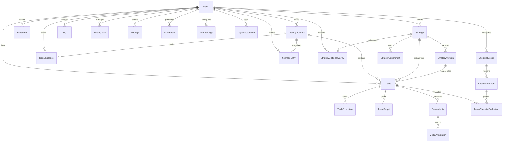
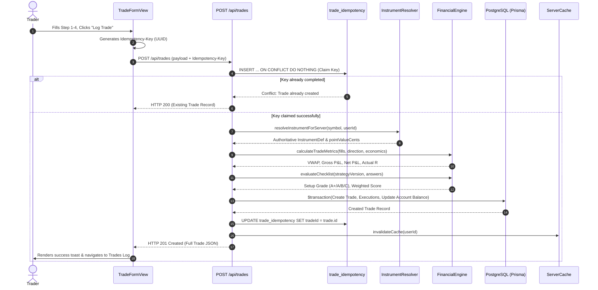
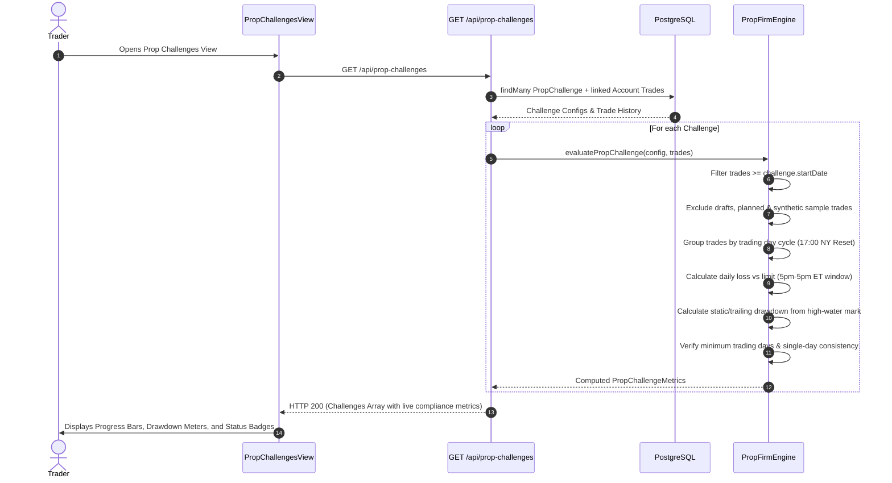

# ALPHAPIPS — DATA & API ARCHITECTURE REFERENCE
**Authoritative Backend Specification, Prisma Schema Catalog & Complete API Inventory**

---

## 1. BACKEND ARCHITECTURE & DATA ACCESS PATTERN

AlphaPips utilizes Next.js 16 Route Handlers backed by Prisma ORM 6.11 connecting to PostgreSQL (Neon serverless / pooled database).

### Core Principles:
1. **Mandatory User Scoping (Simulated RLS):** The application layer enforces strict row-level security on every query by explicitly binding the authenticated `userId` obtained from `requireUser()` (`src/lib/auth.ts`). No user may query, modify, or delete another user's records.
2. **Server-Authoritative Business Logic:** Financial metrics (Net P&L, Gross P&L, Actual R, Setup Grade, Setup Score, Drawdown) are **never computed or trusted from client requests**. The server computes all values using `calculateTradeMetrics` (`src/lib/financial-engine.ts`) and `evaluateChecklist` (`src/lib/checklist-evaluation.ts`).
3. **BigInt Minor-Unit Precision:** All monetary amounts in the database are stored as integers representing cents/minor units (e.g., `$100.50` is stored as `10050` cents). Prices and quantities are stored as high-precision decimal strings to eliminate IEEE 754 floating-point rounding errors.
4. **PostgreSQL Idempotency Table:** Trade creations in `POST /api/trades` use a dedicated, user-scoped table `trade_idempotency` with SHA-256 payload fingerprinting and `INSERT ... ON CONFLICT DO NOTHING` atomic locking to prevent duplicate trade entries during concurrent or retried network submissions.
5. **Audit Trail Logging:** State mutations across trades, strategies, accounts, imports, and backups emit structured records into the `AuditEvent` table via `auditForUser()` (`src/lib/audit.ts`).

---

## 2. PRISMA SCHEMA & ENTITY RELATIONSHIP REFERENCE

### 2.1 Complete Model Catalog (35 Models)

### 2.2 Model Specifications

#### 1. `User`
- **Purpose:** Core account entity representing an authenticated trader.
- **Fields:**
  - `id`: `String` (CUID, PK).
  - `email`: `String` (Unique, lowercase normalized).
  - `name`: `String?` (Display name).
  - `passwordHash`: `String` (Bcrypt salt rounds: 12).
  - `createdAt`, `updatedAt`: `DateTime`.
- **Relations:** Cascading delete to all user-owned domain records.

#### 2. `TradingAccount`
- **Purpose:** Segregated capital account or broker portfolio instance.
- **Fields:**
  - `id`: `String` (CUID, PK).
  - `userId`: `String` (FK to User, indexed).
  - `name`: `String` (e.g. "FTMO 100k Challenge", "Main Live IC Markets").
  - `broker`: `String?`.
  - `accountType`: `String` (`live`, `demo`, `prop`, `funded`, `backtest`, `personal`, `other`).
  - `currency`: `String` (ISO 4217: `USD`, `EUR`, `GBP`, `JPY`, etc.).
  - `startingBalanceCents`: `Int` (Default 100000 = $1,000.00).
  - `currentBalanceCents`: `Int` (Default 100000 = $1,000.00).
  - `consistencyRate`: `Float?` (Target single-day consistency ceiling, e.g. 50%).
  - `dailyLossLimitPct`: `Float?` (Daily loss ceiling threshold).
  - `maxDrawdownPct`: `Float?` (Maximum account drawdown threshold).
  - `isDefault`: `Boolean` (Default account for trade entry).
  - `isArchived`: `Boolean` (Soft-archive flag).
  - `archivedAt`: `DateTime?`.

#### 3. `Instrument`
- **Purpose:** Custom user instrument overrides and asset class parameters.
- **Fields:**
  - `id`: `String` (CUID, PK).
  - `userId`: `String` (FK to User).
  - `symbol`: `String` (Normalized uppercase ticker, e.g. `EURUSD`, `XAUUSD`, `NQ`).
  - `name`: `String?`.
  - `market`: `String` (`forex`, `gold`, `indices`, `futures`, `crypto`, `stocks`, `custom`).
  - `pipSize`: `String` (Decimal string, e.g. "0.0001", "0.01").
  - `tickSize`: `String` (Decimal string, e.g. "0.25", "0.01").
  - `contractSize`: `String` (Informational unit sizing, e.g. "100000", "100", "20").
  - `pricePrecision`: `Int` (Display decimal places: 0 to 5).
  - `currency`: `String` (Settlement/quote currency).
- **Constraints:** `@@unique([userId, symbol])`.

#### 4. `Strategy` & `StrategyVersion`
- **Purpose:** User playbooks with immutable historical rule versioning.
- **`Strategy` Fields:**
  - `id`: `String` (CUID, PK).
  - `userId`: `String` (FK to User).
  - `name`: `String`.
  - `description`, `purpose`: `String?`.
  - `instruments`, `market`, `timeframe`, `session`: `String?`.
  - `status`: `String` (`active`, `paused`, `archived`).
  - `isArchived`: `Boolean`, `archivedAt`: `DateTime?`.
  - `checklistConfigId`: `String?` (FK to ChecklistConfig).
- **`StrategyVersion` Fields:**
  - `id`: `String` (CUID, PK).
  - `strategyId`: `String` (FK to Strategy).
  - `versionLabel`: `String` (e.g. "1.0", "1.1", "2.0").
  - `changeReason`, `changeSummary`, `expectedImpact`: `String?`.
  - `rulesJson`: `String` (JSON array of rules or categorized rules with weights).
  - `checklistJson`: `String?` (Optional embedded checklist override).
  - `effectiveDate`: `DateTime`.
  - `status`: `String` (`active`).
- **Constraints:** `@@unique([strategyId, versionLabel])`.

#### 5. `Trade`
- **Purpose:** Authoritative execution ledger record.
- **Fields:**
  - `id`: `String` (CUID, PK).
  - `userId`: `String` (FK to User).
  - `accountId`: `String` (FK to TradingAccount).
  - `instrumentId`: `String?` (FK to Instrument).
  - `instrumentSymbol`: `String` (Denormalized uppercase symbol for resilience).
  - `market`: `String?`.
  - `direction`: `String` (`long`, `short`).
  - `status`: `String` (`open`, `win`, `loss`, `breakeven`, `partial_win`, `partial_loss`, `cancelled`).
  - `session`: `String?` (`asia`, `london`, `ny_am`, `ny_pm`, `custom`).
  - `newsEvent`: `String?` (Structured key: `none`, `nfp`, `cpi`, `fomc`, `ppi`, etc.).
  - `strategyId`: `String?`, `strategyVersionId`: `String?`.
  - `setupGrade`: `String?` (`A+`, `A`, `B`, `C`, `Invalid`).
  - `setupScore`: `String?` (Decimal string 0.00 to 1.00).
  - `tagsJson`: `String` (JSON array of tag strings).
  - `plannedEntryPrice`, `plannedStopPrice`, `plannedTargetPrice`: `String?` (Decimal strings).
  - `plannedRiskAmountCents`: `Int?`, `plannedRiskPct`: `String?`, `plannedRR`: `String?`.
  - `entryPriceAvg`, `exitPriceAvg`, `positionSize`: `String?` (Server-computed VWAPs and total lots/contracts).
  - `feesCents`, `commissionCents`, `swapCents`, `slippageCents`: `Int` (Default 0).
  - `grossPnlCents`: `Int` (Server-computed gross profit/loss).
  - `netPnlCents`: `Int` (Gross minus all fees and costs).
  - `actualR`: `String?` (Realized risk multiple: `netPnl / plannedRisk`).
  - `entryTime`, `exitTime`: `DateTime?`.
  - `tradingTimezone`: `String` (Default "UTC").
  - `setupJson`, `thesisJson`, `notes`, `lessons`: `String?`.
  - `planAdherenceJson`: `String?` (Evaluated rule adherence structure).
  - `psychBeforeJson`, `psychAfterJson`, `behaviorFlagsJson`: `String?`.
  - `isDraft`: `Boolean`, `draftJson`: `String?`.
  - `isArchived`: `Boolean`, `archivedAt`: `DateTime?`.

#### 6. `TradeExecution` & `TradeTarget`
- **`TradeExecution`:** Immutable fill records.
  - `id`: `String` (PK).
  - `tradeId`: `String` (FK to Trade, cascade delete).
  - `kind`: `String` (`entry`, `exit`).
  - `seq`: `Int` (Order of execution).
  - `price`: `String`, `quantity`: `String` (Decimal strings).
  - `timestamp`: `DateTime`.
- **`TradeTarget`:** Pre-planned partial take-profit levels.
  - `id`: `String` (PK).
  - `tradeId`: `String` (FK to Trade, cascade delete).
  - `label`: `String` (`TP1`, `TP2`, `TP3`).
  - `price`: `String`, `quantityPct`: `String` (0.00 to 1.00).

#### 7. `TradeMedia` & `MediaAnnotation`
- **Purpose:** Trade-specific chart evidence and geometric drawing overlays.
- **Fields:**
  - `id`: `String` (PK).
  - `userId`, `tradeId`: `String` (Cascade delete on trade).
  - `kind`: `String` (`image`, `video`).
  - `stage`: `String` (`before_entry`, `setup`, `entry`, `during_trade`, `exit`, `review`).
  - `filename`, `storedPath`, `mimeType`: `String`.
  - `sizeBytes`, `width`, `height`: `Int?`.
  - `timeframe`: `String?` (e.g. `5m`, `15m`, `1h`).
- **Annotations (`MediaAnnotation`):** `kind` (`line`, `arrow`, `rect`, `circle`, `text`, `price`), `payloadJson` (coordinates & styles).

#### 8. `TradeChecklistEvaluation`
- **Purpose:** Immutable audit record of checklist answers submitted for a trade.
- **Fields:**
  - `id`: `String` (PK).
  - `tradeId`: `String` (FK to Trade).
  - `strategyVersionId`: `String?` (FK to StrategyVersion).
  - `rawAnswersJson`: `String` (`{ itemId: { checked: boolean, note: string } }`).
  - `weightedScore`: `String` (Decimal 0.00 to 1.00).
  - `finalGrade`: `String` (`A+`, `A`, `B`, `C`, `Invalid`).
  - `evaluatedAt`: `DateTime`.

#### 9. `PropChallenge`
- **Purpose:** Prop firm evaluation challenge and funded compliance tracking.
- **Fields:**
  - `id`: `String` (PK).
  - `userId`: `String` (FK to User).
  - `accountId`: `String` (FK to TradingAccount, cascade delete).
  - `name`: `String` (e.g. "FTMO 100k Stage 1").
  - `propFirm`: `String` (e.g. "FTMO", "FundingPips").
  - `stage`: `String` (`phase1`, `phase2`, `funded`).
  - `status`: `String` (`active`, `passed`, `failed`, `expired`).
  - `startingBalanceCents`: `Int`.
  - `profitTargetCents`: `Int?`.
  - `dailyLossLimitCents`: `Int?`, `dailyLossLimitPct`: `Float?`.
  - `maxDrawdownCents`: `Int?`, `maxDrawdownPct`: `Float?`.
  - `drawdownType`: `String` (`static`, `trailing`).
  - `trailingHighWaterMarkCents`: `Int?`.
  - `minTradingDays`: `Int?` (Default 4), `maxTradingDays`: `Int?`.
  - `resetTimezone`: `String` (Default `America/New_York`).
  - `resetHour`: `Int` (Default 17 = 5:00 PM).
  - `startDate`: `DateTime`, `endDate`: `DateTime?`.
  - `notes`: `String?` (Contains JSON-encoded `ChallengeMetadata` including consistency rules).

#### 10. `NoTradeEntry`
- **Purpose:** Market restraint journal entries for skipped, missed, or rejected setups.
- **Fields:**
  - `id`: `String` (PK).
  - `userId`: `String` (FK to User).
  - `instrumentSymbol`: `String`, `instrumentId`: `String?`.
  - `accountId`: `String?`, `strategyId`: `String?`, `strategyVersionId`: `String?`.
  - `date`: `DateTime`, `time`: `String?`, `session`: `String?`, `timeframe`: `String?`.
  - `bias`: `String?` (`bullish`, `bearish`, `neutral`).
  - `reasonCategory`: `String` (`no_valid_setup`, `poor_rr`, `confirmation_missing`, `news_risk`, `spread_high`, `daily_loss_reached`, `emotional_psychological`, `limit_reached`, `other`).
  - `decisionType`: `String` (`deliberate_avoidance`, `missed`, `rejected`, `not_ready`).
  - `status`: `String` (`observing`, `waiting_confirmation`, `rejected`, `missed`, `invalidated`, `completed`).
  - `isArchived`: `Boolean`, `archivedAt`: `DateTime?`.

#### 11. `UserSettings`
- **Purpose:** Global user preferences and risk thresholds.
- **Fields:**
  - `userId`: `String` (PK, FK to User).
  - `timezone`: `String` (Default "UTC").
  - `theme`: `String` (`nordic`, `terminal`, `institutional`).
  - `density`: `String` (`comfortable`, `compact`, `spacious`).
  - `largerText`: `Boolean`, `reducedMotion`: `Boolean`.
  - `defaultRiskPct`: `String` (Default "0.5").
  - `normalRiskMaxPct`: `Float` (Default 1.5).
  - `warningRiskMaxPct`: `Float` (Default 3.0).
  - `criticalRiskMaxPct`: `Float` (Default 5.0).
  - `defaultAccountId`: `String?`.
  - `privacyModeEnabled`: `Boolean` (Default false).

#### 12. Additional Supporting Models:
- `TradingTask`: Workflow to-do tasks and pre-session checklists.
- `StrategyDictionaryEntry`: Strategy-specific terminology glossaries.
- `FilterPreset`: Saved filter configurations for Trades Log and Analytics.
- `Backup`: Metadata for JSON archive backups.
- `AuditEvent`: System audit log capturing user actions.
- `LegalAcceptance`: Versioned Terms and Privacy Policy acceptance records.
- `Notification` & `NotificationPreferences`: System, journal, and trading alerts.
- `DeviceSession`: Active session tracking and revocation.
- `AnalyticsCache`: Server-side performance aggregation caching.

---

## 3. COMPLETE API INVENTORY (48 ROUTES)

### 3.1 Authentication & Profile (`/api/auth`, `/api/me`)

| Endpoint | Method | Purpose | Auth & Validation | Data Read/Written | Status |
| :--- | :--- | :--- | :--- | :--- | :--- |
| `/api/auth` | `GET` | Retrieve session user | Validates `dnd_session` JWT | Reads `User`, `UserSettings` | 200 / 401 |
| `/api/auth` | `POST` | User login or registration | `mode=signin`: `SignInSchema` `mode=signup`: `SignUpSchema` (requires Terms + Privacy checkboxes) | Writes `User`, `UserSettings`, `NotificationPreferences`, `LegalAcceptance`, sets JWT cookie | 200 / 400 / 401 |
| `/api/auth` | `DELETE` | Session logout | Clears session cookie | Clears in-memory session cache | 200 |
| `/api/me` | `GET` | User bootstrap data | `requireUser()` | Reads `User`, `TradingAccount` count, `Trade` count | 200 / 401 |
| `/api/delete-account` | `POST` | Permanent account purge | `requireUser()`, password confirmation | Cascade deletes `User` and all related entities | 200 / 400 |

### 3.2 Trades & Executions (`/api/trades`)

| Endpoint | Method | Purpose | Auth & Validation | Business Logic & Side Effects | Status |
| :--- | :--- | :--- | :--- | :--- | :--- |
| `/api/trades` | `GET` | Paginated trades list | `requireUser()`, `ListQuerySchema` (filters, sorting, cursor) | Reads `Trade` (filtered by `userId`, `accountId`, `isArchived: false`). Computes summary stats. | 200 / 401 |
| `/api/trades` | `POST` | Authoritative trade creation | `requireUser()`, `TradeCreateSchema`, `Idempotency-Key` header | 1. Claims idempotency lock (`trade_idempotency`). 2. Resolves instrument economics from catalog. 3. Computes VWAPs, gross/net P&L, actual R, planned RR. 4. Evaluates checklist answers against StrategyVersion. 5. Updates account balance transactionally. 6. Invalidates user cache and logs audit event. | 201 / 400 / 409 |
| `/api/trades/[id]` | `GET` | Individual trade detail | `requireUser()`, trade ownership check | Reads `Trade`, `executions`, `targets`, `media`, `checklistEvaluations`. | 200 / 404 |
| `/api/trades/[id]` | `PATCH` | Update existing trade | `requireUser()`, partial schema | Re-calculates metrics if executions change; adjusts account balance difference; records audit event. | 200 / 400 |
| `/api/trades/[id]` | `DELETE` | Soft-archive or purge trade | `requireUser()` | Soft-archives (`isArchived: true`) or deletes; reverts account balance impact. | 200 / 404 |
| `/api/trades/[id]/duplicate` | `POST` | Clone trade as new draft | `requireUser()` | Copies parameters to new trade with status `draft`. | 201 / 404 |

### 3.3 Accounts (`/api/accounts`)

| Endpoint | Method | Purpose | Validation | Data Touched | Status |
| :--- | :--- | :--- | :--- | :--- | :--- |
| `/api/accounts` | `GET` | List active accounts | `requireUser()` | Reads `TradingAccount` where `userId = user.id` and `isArchived: false`. | 200 |
| `/api/accounts` | `POST` | Create trading account | `AccountSchema` (name, currency, balance, type) | Creates `TradingAccount`. If `isDefault`, unsets previous default. | 201 / 400 |
| `/api/accounts/[id]` | `GET` | Account detail & stats | `requireUser()` | Reads account, trade counts, aggregate net P&L. | 200 / 404 |
| `/api/accounts/[id]` | `PATCH` | Update account settings | Partial schema | Updates balance, risk limits, consistency target. | 200 / 400 |
| `/api/accounts/[id]` | `DELETE` | Soft-archive account | `requireUser()` | Sets `isArchived: true`, `archivedAt: now()`. | 200 / 404 |

### 3.4 Prop Challenges & Intelligence (`/api/prop-challenges`)

| Endpoint | Method | Purpose | Logic & Verification | Status |
| :--- | :--- | :--- | :--- | :--- |
| `/api/prop-challenges` | `GET` | List challenges & evaluations | Evaluates compliance across all active challenges using `evaluatePropChallenge()`. | 200 |
| `/api/prop-challenges` | `POST` | Create prop challenge | Binds to `accountId`, defines rules, starting balance, timezone reset, consistency action. | 201 / 400 |
| `/api/prop-challenges/[id]` | `GET` | Challenge detail & diagnosis | Computes daily cycle P&L (17:00 NY reset), high-water mark, failure diagnosis, and payout status. | 200 / 404 |
| `/api/prop-challenges/[id]` | `PATCH` | Update rules or record rejection | Updates rule thresholds or records manual firm dispute / external breach rejection. | 200 / 400 |
| `/api/prop-challenges/[id]` | `DELETE` | Remove challenge tracker | Deletes tracker record (leaves account and trades intact). | 200 / 404 |

### 3.5 Analytics & Performance (`/api/analytics`, `/api/dashboard`, `/api/calendar`)

| Endpoint | Method | Purpose | Computations Performed | Status |
| :--- | :--- | :--- | :--- | :--- |
| `/api/dashboard` | `GET` | Command center summary | 5 primary KPIs (Net P&L, Win Rate, Profit Factor, Trade Count, Avg R), equity curve, daily P&L. | 200 |
| `/api/analytics` | `GET` | Comprehensive performance analytics | Computes all 9 analytics tabs: metrics, instruments, setups, drawdown underwater curve, holding time distribution, sessions/weekdays, checklist adherence, violations. | 200 |
| `/api/calendar` | `GET` | Timezone-aware day grouping | Groups trades by `exitTime` into calendar days formatted in user's IANA timezone. | 200 |

### 3.6 Strategies & Checklists (`/api/strategies`, `/api/checklists`, `/api/dictionary`)

| Endpoint | Method | Purpose | Versioning Logic | Status |
| :--- | :--- | :--- | :--- | :--- |
| `/api/strategies` | `GET` / `POST` | List and create playbooks | Initializes `Strategy` with initial `StrategyVersion` (v1.0). | 200 / 201 |
| `/api/strategies/[id]` | `GET` | Strategy detail & versions | Computes aggregate metrics and version performance breakdowns. | 200 / 404 |
| `/api/strategies/[id]` | `PATCH` | Edit or upgrade version | If `updateCurrentVersion: true`, modifies current version in-place. If version upgrade, creates new `StrategyVersion`. | 200 / 400 |
| `/api/strategies/[id]/compare` | `GET` | Side-by-side version comparison | Computes rule diffs (added/removed/unchanged) and comparative metrics. | 200 / 404 |
| `/api/dictionary` | `GET` / `POST` | Strategy terminology glossary | Manages strategy-specific and personal trading definitions. | 200 / 201 |
| `/api/checklists` | `GET` / `POST` | Reusable checklist configs | Versioned checklist definitions and weights. | 200 / 201 |

### 3.7 Market Restraint & Tasks (`/api/no-trades`, `/api/tasks`)

| Endpoint | Method | Purpose | Scope & Exclusions | Status |
| :--- | :--- | :--- | :--- | :--- |
| `/api/no-trades` | `GET` / `POST` | Log and query observations | Records market observations, missed setups, and restraint reasons. Strictly excluded from P&L and win rate. | 200 / 201 |
| `/api/no-trades/[id]` | `GET` / `PATCH` | Update observation | Updates follow-up notes, price action outcome, or archives entry. | 200 / 404 |
| `/api/tasks` | `GET` / `POST` | Trading workflow tasks | Manages Inbox, Watchlist, Research, Execution, Routine tasks and subtasks. | 200 / 201 |
| `/api/tasks/[id]` | `PATCH` / `DELETE` | Complete or modify task | Updates status (`pending`, `completed`), pinned status, priority. | 200 / 204 |

### 3.8 Administration, Data & Portability (`/api/backups`, `/api/archive`, `/api/imports`, `/api/settings`)

| Endpoint | Method | Purpose | Safety Mechanisms | Status |
| :--- | :--- | :--- | :--- | :--- |
| `/api/backups` | `GET` / `POST` | Create Schema 2.0 backup | Exports all 12 core user entities into portable JSON format. | 200 / 201 |
| `/api/backups/preview` | `POST` | Pre-restore inspection report | Analyzes archive JSON structure and scores duplicates (100%, 85%, 60%, 0%). | 200 / 400 |
| `/api/archive` | `GET` / `POST` | Soft-archive and restore | Actions `archive` or `restore` on trades, accounts, strategies, and observations. | 200 / 400 |
| `/api/settings` | `GET` / `PATCH` | User settings & appearance | Updates timezone, theme, density, privacy mode, and risk threshold banners. | 200 / 400 |
| `/api/search` | `GET` | Global fuzzy search | Searches trades, accounts, strategies, tasks, and dictionary entries. | 200 |
| `/api/legal/[doc]` | `GET` | Markdown legal doc viewer | Serves current Terms of Service, Privacy Policy, or Cookie Policy. | 200 / 404 |
| `/api/media` | `POST` | Upload trade screenshot | Stores file in local/cloud storage; links to trade; validates MIME types. | 201 / 400 |
| `/api/media/[id]` | `DELETE` | Delete trade screenshot | Removes file and annotations. | 200 / 404 |
| `/api/filter-presets` | `GET` / `POST` | Saved filter presets | Saves filter configurations for Trades Log and Analytics. | 200 / 201 |

---

## 4. END-TO-END COMMUNICATION FLOWS

### 4.1 Trade Creation with Idempotency & Financial Engine Flow

### 4.2 Prop Challenge Evaluation & NY 17:00 Reset Flow

