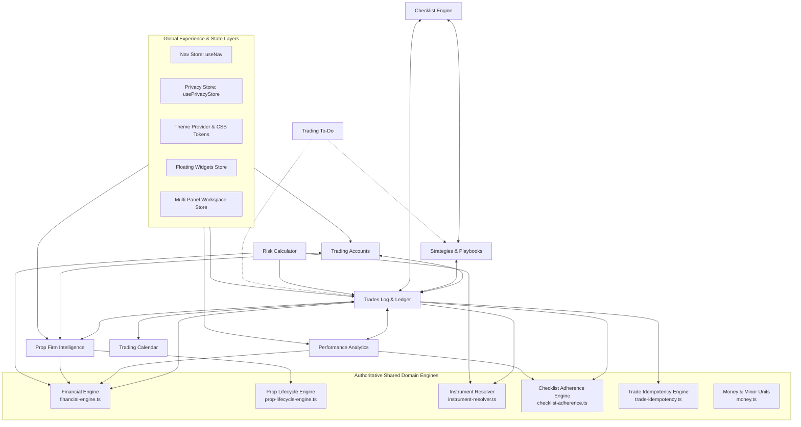

# ALPHAPIPS — MODULE DEPENDENCY & SHARED SERVICES MAP
**System-Wide Interconnection Architecture, Shared Domain Services & Change-Impact Analysis**

---

## 1. HIGH-LEVEL SYSTEM INTERCONNECTION TOPOLOGY

AlphaPips is built around tightly interconnected, highly cohesive financial and workflow domains. No individual module operates in isolation.

---

## 2. DETAILED DOMAIN RELATIONSHIP CATALOG

### 2.1 Trades Log ↔ Trading Accounts
- **Data Flow:** Every trade is strictly bound to an `accountId` (`TradingAccount.id`).
- **Account Isolation:** Changing the global account selector in the TopBar or Trades Log filters trades to `where: { accountId }`.
- **Balance Mutation:** When a trade transitions to `win`, `loss`, `breakeven`, `partial_win`, or `partial_loss`, the backend atomically updates `TradingAccount.currentBalanceCents += trade.netPnlCents` inside a single Prisma transaction (`$transaction`).
- **Archive / Deletion Ripple:** If an account is soft-archived, its associated trades remain historically intact in the database but are hidden from active account dropdowns.
- **Currency Propagation:** The account's base currency (`TradingAccount.currency`) dictates currency conversion requirements in `financial-engine.ts`.

### 2.2 Trades Log ↔ Strategies & Strategy Versions
- **Data Flow:** Trades link optionally to `strategyId` and `strategyVersionId`.
- **Historical Snapshots:** When a strategy rule is updated via version upgrade (e.g. `v1.0` → `v1.1`), existing trades retain their link to `v1.0`. Historical performance attribution reflects the strategy configuration that applied when the trade was executed.
- **In-Place Editing Impact:** If the user edits the current version without upgrading (`updateCurrentVersion: true`), optimistic concurrency checks (`expectedVersionId`, `expectedUpdatedAt`) prevent conflicting overwrites.
- **Custom Strategy Fields:** Flexible strategy fields defined in `StrategyVersion.rulesJson` dynamically render custom inputs inside `TradeFormView` (Step 1).

### 2.3 Trades Log ↔ Checklist Engine
- **Data Flow:** Submitted checklist answers are evaluated server-side and stored in `TradeChecklistEvaluation`.
- **Adherence Calculation:** `checklist-adherence.ts` reads `rawAnswersJson` from each trade and scores adherence against required items from the linked `StrategyVersion.rulesJson`.
- **Grade & Score Authority:** Even if a client sends a fraudulent `setupGrade: "A+"`, the server recomputes the score and grade using `evaluateChecklist()` before database insertion.

### 2.4 Trades Log ↔ Performance Analytics
- **Data Flow:** Analytics Engine fetches trades matching user-selected filters (`accountId`, `strategyId`, date range, session).
- **Execution:** Passes `TradeMetricRow[]` into `computeAggregateMetrics()` (`financial-engine.ts`).
- **Population Integrity:** Synthetic demo trades (`isSyntheticSampleTrade`) and market restraint observations (`NoTradeEntry`) are strictly segregated from financial metrics.

### 2.5 Trading Accounts & Trades ↔ Prop Challenges
- **Data Flow:** A `PropChallenge` binds directly to a single `TradingAccount`.
- **Evaluation Mechanism:** `evaluatePropChallenge()` reads all trades associated with the linked account on or after `PropChallenge.startDate`.
- **Cycle Reset:** Trades are bucketed into trading day cycles based on the challenge's `resetTimezone` (default: `America/New_York`) and `resetHour` (17:00 / 5:00 PM).
- **Failure Trigger:** If the cumulative loss in an active cycle breaches `dailyLossLimitCents`, or running equity breaches `maxDrawdownCents`, the challenge transitions to `breached`.

### 2.6 Calendar ↔ Trades & Observations
- **Data Flow:** `GET /api/calendar` reads trades and no-trade observations for the active month.
- **Timezone Grouping:** Buckets records into calendar days based on the user's localized `UserSettings.timezone`.
- **Contextual Transition:** Clicking a day cell navigates to `TradesLogView` with filter `fromDate = YYYY-MM-DD` and `toDate = YYYY-MM-DD`.

### 2.7 Global Widgets ↔ Account & Risk Data
- **Data Flow:**
  - `Drawdown Monitor` queries active account balance and computes high-water mark.
  - `Quick Risk Calculator` consumes selected account balance and catalog instrument point values.
  - `Daily Risk Limit` monitors today's realized loss against user settings limit.
- **UI Independence:** Widgets float over any view and persist coordinates and minimization states in localStorage (`alphapips-floating-widgets`).

### 2.8 Multi-Panel Workspace ↔ Application Views
- **Data Flow:** `useWorkspaceStore` mounts 2 to 4 independent sub-views (`DashboardView`, `TradesLogView`, `TradeDetailView`, `AnalyticsView`, `RiskCalculatorView`, etc.) in resizable panels.
- **Context Synchronization:** Selecting a trade in a Trades Log panel updates `workspaceStore.linkedTradeId`, which immediately updates any open `TradeDetailView` panel without a full route transition.

---

## 3. SHARED CORE LIBRARIES & INTERNAL APIS

| Library Path | Responsibility | Dependent Callers | Critical Functions / Exports |
| :--- | :--- | :--- | :--- |
| `src/lib/financial-engine.ts` | Authoritative financial mathematics and analytics engine. | `/api/trades`, `/api/analytics`, `/api/dashboard`, `/api/strategies/[id]`, Trade Form, Risk Calculator | `calculateTradeMetrics()`, `calculatePositionSize()`, `computeAggregateMetrics()`, `buildEquityCurve()`, `buildDailyPnl()` |
| `src/lib/prop-firm-engine.ts` | Daily cycle grouping (17:00 NY reset), static/trailing drawdown, consistency rules. | `/api/prop-challenges`, Prop Challenge Views, Floating Widgets | `getTradingCycleKey()`, `evaluatePropChallenge()`, `isSyntheticSampleTrade()`, `parseChallengeMetadata()` |
| `src/lib/prop-lifecycle-engine.ts` | Multi-phase lifecycle progression, failure diagnosis, dispute tracking, payouts. | `/api/prop-challenges/[id]`, Prop Challenge Detail View | `evaluatePropLifecycle()`, `transitionToNextPhase()`, `recordManualFirmRejection()`, `requestPayout()`, `simulateHypotheticalScenario()` |
| `src/lib/checklist-adherence.ts` | True checklist adherence decoupled from win rate. | `/api/analytics`, Analytics View, Dashboard View, Strategy Detail | `evaluateTradeAdherence()`, `computeChecklistAdherenceSummary()` |
| `src/lib/checklist-evaluation.ts` | Checklist parsing, item weights, scoring, and grade assignment. | `/api/trades`, `/api/checklists`, Trade Form | `evaluateChecklist()`, `extractChecklist()`, `parseAnswers()`, `serializeAnswers()` |
| `src/lib/instrument-catalog.ts` | Static catalog of 50+ financial instruments across 5 asset classes. | Instrument Resolver, Risk Calculator, Trade Form | `INSTRUMENT_CATALOG`, `findInstrument()`, `resolveInstrument()`, `getInstrumentSizingRules()` |
| `src/lib/instrument-resolver.ts` | Single authoritative server resolver checking DB custom instruments then catalog. | `/api/trades`, Trade Form | `resolveInstrumentForServer()` |
| `src/lib/trade-idempotency.ts` | PostgreSQL atomic reservation and payload fingerprinting. | `POST /api/trades` | `computeTradePayloadHash()`, `claimIdempotencyKey()`, `finalizeIdempotencyKey()`, `releaseIdempotencyKey()` |
| `src/lib/money.ts` | Minor units string formatting, signed dollar formatting, tabular numerals. | All Views, Dashboard, Trades Log, Calendar | `formatSignedCents()`, `formatPrice()`, `formatR()`, `centsToNumberString()`, `formatPct()` |
| `src/lib/decimal.ts` | Decimal.js wrapper and BigInt banking round helpers. | `financial-engine.ts`, Risk Calculator | `Decimal`, `dToNumber()`, `dDiv()`, `dSub()`, `dAbs()`, `dCmp()` |
| `src/lib/auth.ts` | Bcrypt password hashing, Jose JWT signing, session cookies, user isolation. | All API routes, AppShell | `requireUser()`, `getSessionUser()`, `hashPassword()`, `verifyPassword()`, `createSessionToken()` |
| `src/lib/privacy-store.ts` | Global privacy mode masking balance numbers (`••••••`). | TopBar, Dashboard, Trades Log, Accounts, Widgets | `usePrivacyStore`, `maskSignedCents()`, `maskAccountName()` |

---

## 4. SYSTEM CHANGE IMPACT ANALYSIS MATRIX

This matrix details the cascading ripple effects of modifying any shared database model or domain engine:

| Component / File Modified | Primary Functionality Affected | Secondary Modules Impacted | Required Regression Verification |
| :--- | :--- | :--- | :--- |
| **`prisma/schema.prisma` (`Trade` model)** | Database schema for trade records. | `/api/trades`, `/api/backups`, Trades Log View, Trade Form View, Trade Detail View. | Run `npx prisma generate`; verify backup JSON serialization (`Schema 2.0`); verify trade creation idempotency. |
| **`src/lib/financial-engine.ts`** | All P&L, position sizing, R-multiple, and drawdown calculations. | Dashboard, Trades Log, Trade Detail, Analytics (all 9 tabs), Prop Challenges, Risk Calculator. | Run `bun test src/lib/financial-engine.test.ts` (all 60 tests must pass); verify XAUUSD $1.00 move test and NQ futures test. |
| **`src/lib/prop-firm-engine.ts`** | 17:00 NY cycle reset and prop compliance evaluation. | Prop Challenges View, Prop Challenge Detail, Accounts View, Drawdown Monitor widget, Daily Risk Limit widget. | Run `bun test src/lib/prop-firm-engine.test.ts` and `src/lib/prop-lifecycle.test.ts`; verify DST transition invariance. |
| **`src/lib/checklist-adherence.ts`** | Rule adherence scoring. | Analytics Checklist tab, Dashboard Process Breakdown, Strategy Detail version performance. | Run `bun test src/lib/checklist-adherence.test.ts`; verify win-rate decoupling and missing-data flags. |
| **`src/lib/instrument-catalog.ts`** | Symbol point values, tick sizes, contract sizes, quote currencies. | Trade creation P&L calculations, Risk Calculator position sizing, Instrument Selector dropdowns. | Run `bun test src/lib/instrument-catalog.test.ts`; verify Forex, Gold, Silver, Indices, and Crypto point values. |
| **`src/lib/trade-idempotency.ts`** | Trade submission concurrency locking. | `POST /api/trades` route handler, network retry resilience. | Run `bun test src/lib/trade-idempotency.test.ts`; verify concurrent race condition handling and 409 conflict rejection. |
| **`src/lib/nav-store.ts`** | Client SPA routing, view selection, scroll position caching. | `AppShell`, Sidebar, TopBar, MobileNav, Global Breadcrumbs. | Verify SPA view switching without page reload; verify scroll restoration across views. |
| **`src/app/globals.css` (Themes/Tokens)** | Visual identity, themes, typography roles, contrast. | All UI components, buttons, tables, cards, charts, modals. | Verify WCAG AA contrast matrix across Nordic, Terminal, and Slate Contrast; verify 6 font families render distinctly. |
| **`src/lib/workspace-store.ts`** | Multi-Panel Workspace state and layout. | Multi-Panel Workspace, Panel maximization, Panel trade context linking. | Run `bun test src/lib/phase5-workspace-widgets.test.ts`; verify panel count boundaries (1-4) and 380px min width. |
