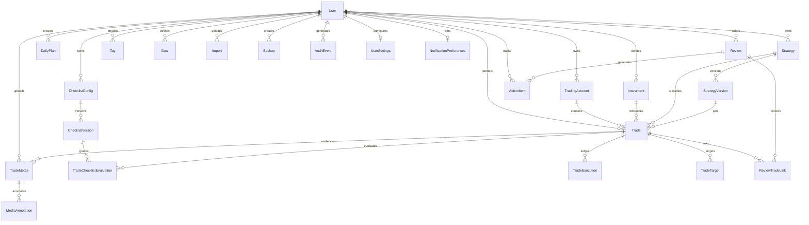
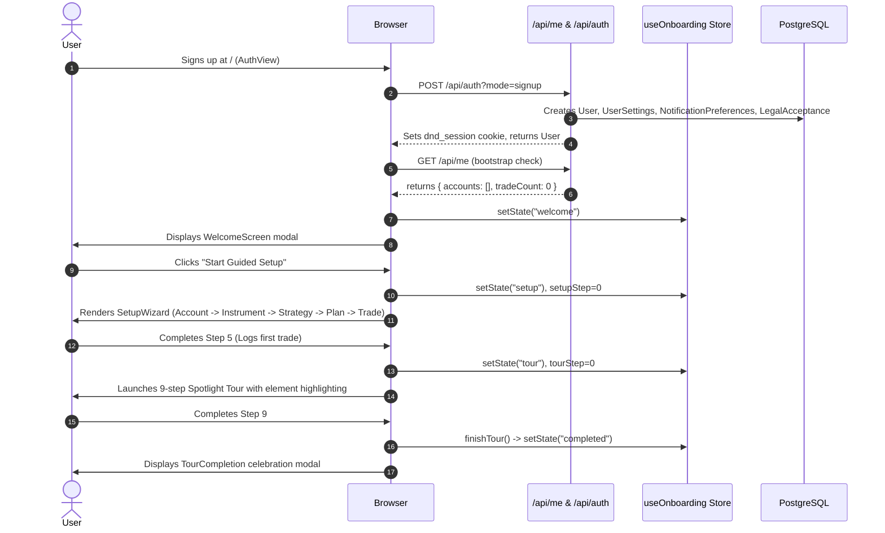
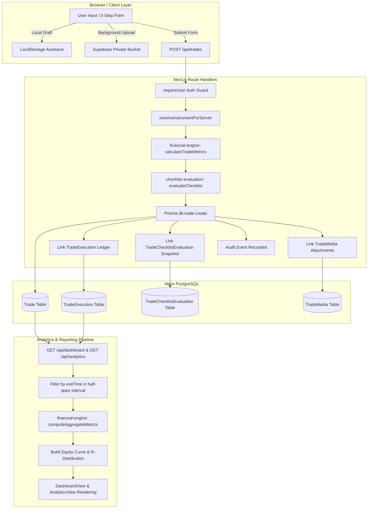

# TRADING JOURNAL PROJECT AUDIT & SYSTEM ARCHITECTURE DOCUMENTATION
**Project Name:** DnD — Trading Performance OS  
**Audit Date:** November 2026 (Local System Time: 2026-11-11)  
**Codebase Snapshot:** `c:\Users\hp\Downloads\DnD_COMPLETE_LATEST_20260915`  
**Auditor:** Senior Full-Stack Software Architect, Database Architect, Financial Systems Engineer & Product Analyst  
**Document Status:** Complete & Authoritative (Read-Only Inspection Phase)

---

## TABLE OF CONTENTS

1. [Executive Summary](#1-executive-summary)
2. [Complete Technology Stack](#2-complete-technology-stack)
3. [Project Folder & Architecture Overview](#3-project-folder--architecture-overview)
4. [Frontend Architecture & State Machine](#4-frontend-architecture--state-machine)
5. [Backend Architecture & API Infrastructure](#5-backend-architecture--api-infrastructure)
6. [Database Schema, Models & Relationships](#6-database-schema-models--relationships)
7. [Complete Page & Route Inventory](#7-complete-page--route-inventory)
8. [Navigation & View Hierarchy](#8-navigation--view-hierarchy)
9. [Complete Feature Inventory & Implementation Status](#9-complete-feature-inventory--implementation-status)
10. [UI/UX Design System & Aesthetic Specification](#10-uiux-design-system--aesthetic-specification)
11. [Page-by-Page UI/UX Deep Dive](#11-page-by-page-uiux-deep-dive)
12. [End-to-End User Workflows](#12-end-to-end-user-workflows)
13. [Trading Calculations & Financial Engine Verification](#13-trading-calculations--financial-engine-verification)
14. [Data Flow: UI → Server → Database → Analytics](#14-data-flow-ui--server--database--analytics)
15. [Authentication, Authorization & Security Architecture](#15-authentication-authorization--security-architecture)
16. [Testing, Verification & Quality Assurance](#16-testing-verification--quality-assurance)
17. [Identified Bugs & Technical Debt](#17-identified-bugs--technical-debt)
18. [UX Friction Points & Interaction Inconsistencies](#18-ux-friction-points--interaction-inconsistencies)
19. [Missing, Incomplete & Orphaned Features](#19-missing-incomplete--orphaned-features)
20. [Recommended Improvement Opportunities](#20-recommended-improvement-opportunities)
21. [Critical Questions & Roadmap Recommendations (P0–P3)](#21-critical-questions--roadmap-recommendations-p0p3)

---

## 1. EXECUTIVE SUMMARY

**DnD** is a specialized, private, single-tenant trading performance operating system ("Trading Performance OS") engineered for discretionary futures, forex, commodities, equities, and crypto traders. Unlike generic spreadsheet journals, DnD is architected around strict financial mathematical invariants, institutional risk models, rule adherence tracking, ICT (Inner Circle Trader) style market framework capture, and strategy versioning.

### Key Strengths Discovered
1. **Mathematical Rigor in the Core Engine:** `src/lib/financial-engine.ts` (1,247 lines) implements BigInt-based integer cent arithmetic, arbitrary precision decimal pricing via `decimal.js`, banker's half-even rounding, and a strict separation between informational contract sizes and authoritative `pointValueCents`.
2. **Server-Authoritative Evaluation & Execution Ledger:** Trade P&L and status (`win`, `loss`, `breakeven`, `partial_*`, `open`) are derived server-side from immutable executions rather than client input. Checklist grading incorporates an anti-cheat engine where checklist weights and required-rule caps are strictly enforced on the server.
3. **Reference Aesthetic Realization:** Clean, institutional visual design inspired by `ae-tradingjournal.vercel.app` with three full themes (Nordic Clean default, Sleek Terminal dark, Institutional Blue dark), New York market clocks with automated DST handling, and zero-flash theme persistence.
4. **Rich Multi-Media Evidence System:** Non-blocking screenshot/video evidence upload pipeline with inline SVG vector annotation (lines, arrows, rectangles, circles, text callouts) and zoom/pan review modal.

### Critical Deficiencies & Bugs Discovered
1. **Syntax Comma Bug in Analytics API (`src/app/api/analytics/route.ts#L58`):** Uses the JavaScript comma operator (`if (dimension === "instrument", null)`), causing the instrument breakdown query to always evaluate to `null` and return empty data.
2. **Close Trade Modal Missing Point Multiplier (`src/components/trade/close-trade-modal.tsx#L126`):** Computes estimated P&L as `priceDiff * qty`, omitting `pointValueCents`. On gold, futures, or forex, the live modal preview displays completely erroneous P&L and R estimates.
3. **Broken Function Reference in Imports API (`src/app/api/imports/[id]/route.ts#L104`):** References `computePointValueCents` from a deleted legacy module, short-circuiting to `100` cents ($1/point) for all imported instruments (forex, gold, NQ, ES all miscalculated upon CSV import).
4. **Broken Storage Function in Backup Restore (`src/app/api/backups/route.ts#L91`):** Imports non-existent `readStored` from `@/lib/storage`, causing full backup restoration to crash at runtime.
5. **Orphaned Functional Modules:** `Daily Plans` (`plans-view.tsx`, 748 lines) and `Reviews & Action Items` (`reviews-view.tsx`, 319 lines) are fully implemented with backend Prisma models and API routes, but have zero links in the sidebar navigation or command palette.
6. **Type Safety & Build Bypasses:** `next.config.ts` has `typescript.ignoreBuildErrors: true` enabled to mask 15+ real compiler errors across API endpoints and client views.

---

## 2. COMPLETE TECHNOLOGY STACK

| Layer | Technology | Version | Purpose in Codebase |
|---|---|---|---|
| **Framework** | Next.js (App Router) | `16.1.1` | Standalone server output (`output: "standalone"`), route handlers, React 19 server environment |
| **Runtime & Bundler** | Bun & Node.js | Bun `1.4.0` / Node `24` | Bun test runner, CLI runtime, build orchestration |
| **Language** | TypeScript | `^5.0.0` | Strict typing across financial engine, DB schema, API schemas, and components |
| **Database** | PostgreSQL on Neon | Serverless Pooler | Authoritative cloud database with SSL session and transaction pooling |
| **ORM** | Prisma Client | `^6.11.1` | Type-safe query builder, relation management, `db push` workflow (no migration history) |
| **CSS & Styling** | Tailwind CSS v4 + PostCSS | `^4.0.0` | `@import "tailwindcss"`, design tokens via CSS variables in `globals.css` |
| **Animation** | `tailwindcss-animate`, `tw-animate-css` | `^1.0.7` / `^1.3.5` | Smooth modal transitions, accordion animations, drawer effects |
| **UI Component Library** | shadcn/ui + Radix UI | 48 primitives | Accessible headless primitives: Dialog, Popover, Select, Command, Tabs, Accordion, Tooltip |
| **Iconography** | Lucide React | `^0.525.0` | Consistent iconography across navigation, badges, tables, and metric tiles |
| **Client State** | Zustand | `^5.0.6` | Lightweight persisted stores: `useNav`, `useAuth`, `useOnboarding`, `useConsent` |
| **Server State** | TanStack React Query | `^5.82.0` | Cache management, optimistic UI updates, query invalidation, refetching |
| **Data Visualization** | Recharts | `^2.15.4` | Responsive SVG charts: EquityCurveChart, DailyPnlChart, RDistributionChart, GroupBarChart |
| **Form Handling** | React Hook Form + Zod | `^7.60.0` / `^4.0.2` | Complex form validation, 5-step wizard validation, API schema validation |
| **Financial Math** | `decimal.js` + Native BigInt | `^10.4.3` | Arbitrary precision decimal calculations; BigInt minor-unit cent scaling with banker's rounding |
| **Authentication** | `jose` + `bcryptjs` | `^6.2.10` / `^3.0.3` | HS256 signed stateless JWT in 30-day `httpOnly` cookie; 12-round bcrypt salt hashing |
| **Cloud Storage** | Supabase Storage SDK | `^2.116.0` | Private bucket `media` for screenshots and video evidence; 15-minute HMAC signed URLs |
| **Rich Text & Code** | `@mdxeditor/editor`, `react-markdown` | `^3.39.1` / `^10.1.0` | Markdown notes and lessons formatting |
| **Search Engine** | Custom Fuzzy Search | In-house (`fuzzy-search.ts`) | Levenshtein-based distance matching with typo tolerance in command palette |
| **Time Engine** | IANA `Intl.DateTimeFormat` | Native ECMAScript | Real-time New York market clock with automatic Daylight Saving Time (DST) handling |

---

## 3. PROJECT FOLDER & ARCHITECTURE OVERVIEW

```
DnD_COMPLETE_LATEST_20260915/
├── .env                              # Active environment variables (Neon DB, Supabase, secrets)
├── package.json                      # Project dependencies and script declarations
├── tsconfig.json                     # TypeScript compiler configuration (strict: true)
├── next.config.ts                    # Next.js standalone build configuration and CSP headers
├── prisma/
│   └── schema.prisma                 # Authoritative 25-model Prisma schema (PostgreSQL)
├── scripts/
│   ├── ensure-neon-env.mjs           # Predev/prebuild hook ensuring PostgreSQL connection
│   └── seed-test-trades.ts           # Development mock trade seeder
├── public/
│   ├── logo.svg                      # DnD branding SVG mark
│   └── robots.txt                    # Search crawler rules (private app)
└── src/
    ├── app/
    │   ├── layout.tsx                # Root layout with zero-flash theme bootstrap script
    │   ├── page.tsx                  # Master SPA router driving client view state
    │   ├── globals.css               # Design tokens, themes (Nordic/Terminal/Institutional)
    │   └── api/                      # 40 API route handlers across 26 controller domains
    ├── components/
    │   ├── app-shell.tsx             # Master desktop/mobile wrapper (Sidebar + TopBar + Main)
    │   ├── sidebar.tsx               # Collapsible desktop sidebar with grouped navigation
    │   ├── top-bar.tsx               # Header with Account Selector, Search, Clock, Theme, Profile
    │   ├── mobile-nav.tsx            # Sticky bottom 5-slot navigation bar with dropdown
    │   ├── market-clock.tsx          # Real-time New York session clock with automated DST
    │   ├── command-palette.tsx       # Cmd+K global fuzzy command & trade search modal
    │   ├── theme-provider.tsx        # Event-based client theme manager & CSS variable driver
    │   ├── charts/                   # Recharts wrappers (equity, daily P&L, R-distribution)
    │   ├── common/                   # Reusable widgets (instrument selector, metric cards, tables)
    │   ├── onboarding/               # Welcome modal, 5-step setup wizard, 9-step interactive tour
    │   ├── public/                   # Public landing header/footer, cookie banner, legal viewer
    │   ├── trade/                    # Trade modals: close trade, start trade, image viewer
    │   ├── ui/                       # 48 shadcn/ui primitives
    │   └── views/                    # 16 major screen view components
    ├── hooks/                        # Custom React hooks (use-mobile, use-toast)
    └── lib/                          # Core financial logic, DB client, auth, storage, catalog
        ├── financial-engine.ts       # THE AUTHORITATIVE FINANCIAL ENGINE (P&L, sizing, analytics)
        ├── financial-engine.test.ts  # 60 golden test cases (G01–G60)
        ├── population.test.ts        # 12 population analytics tests (POP-1–POP-12)
        ├── instrument-catalog.ts     # 27 pre-calibrated instrument economic profiles
        ├── instrument-resolver.ts    # Server-side authoritative instrument resolver
        ├── checklist-evaluation.ts   # Server-side checklist scoring & anti-cheat engine
        ├── storage.ts                # Supabase storage wrapper with signed URL generator
        ├── auth.ts                   # JWT session & bcrypt password hashing
        ├── auth-store.ts             # Zustand authentication state
        ├── nav-store.ts              # Zustand navigation & scroll state
        ├── onboarding-store.ts       # Zustand onboarding & tour walkthrough state
        ├── money.ts                  # Currency formatting & cent conversions
        ├── decimal.ts                # Arbitrary precision decimal wrapper
        └── db.ts                     # PrismaClient singleton with PostgreSQL invariant guard
```

---

## 4. FRONTEND ARCHITECTURE & STATE MACHINE

### The SPA Within Next.js App Router
Although built inside Next.js 16 App Router, the application deliberately operates as a **single-page state machine**:
- **Single Root Route:** `src/app/page.tsx` is the sole top-level route. It renders conditionally based on `useAuth()` and `useNav()`:
  - If unauthenticated: renders `LandingView`, `AuthView` (sign in / sign up), `CookieConsent`, and `LegalDocViewer`.
  - If authenticated: renders `AppShell`, `WelcomeScreen`, `SetupWizard`, `Tour`, `TourCompletion`, and `LegalDocViewer`.
- **View Switching:** Navigation occurs by dispatching `useNav.getState().navigate(viewKey, params)`. No browser page reload or Next.js route transitions occur.
- **Scroll Preservation:** `AppShell` automatically captures `main.scrollTop` on view unmount or navigation change, storing it in `useNav.scrollPositions[viewKey]`, and restores it asynchronously upon re-entering that view.

### State Management Topology
1. **Client UI State (Zustand with LocalStorage Persistence):**
   - `useNav`: Active view key, route parameters (`params.id`, `params.accountId`), sidebar collapsed state, command palette toggle, scroll position map.
   - `useAuth`: Current user identity, authentication checking flags, logout action.
   - `useOnboarding`: Onboarding stage (`not_started`, `welcome`, `setup`, `tour`, `completed`), active setup wizard step, active tour step. User-scoped: automatically resets if a different user logs into the same browser.
   - `useConsent`: Cookie preferences (essential, analytics, marketing) accepted status.
2. **Server Data State (TanStack React Query v5):**
   - Query keys: `["dashboard", preset, accountId]`, `["trades", filters]`, `["trade", id]`, `["accounts"]`, `["strategies"]`, `["settings"]`, `["calendar", year, month]`.
   - Mutation and Invalidation: Modals (Close Trade, Execute Trade, Trade Form) perform standard fetch requests, then call `queryClient.invalidateQueries()` across related keys.

---

## 5. BACKEND ARCHITECTURE & API INFRASTRUCTURE

### Endpoint Structure & Request Lifecycle
All backend logic resides in Next.js Route Handlers (`src/app/api/*/route.ts`). Every protected endpoint executes a strict security lifecycle:
1. **Authentication Guard:** Calls `requireUser()` (`src/lib/auth.ts#L148`). Extracts and verifies the `dnd_session` JWT cookie. Returns 401 Unauthorized if invalid.
2. **Payload Parsing & Validation:** Uses `parseJson(req)` (`src/lib/api.ts`) followed by `ZodSchema.safeParse(body)`. Returns 400 Bad Request with formatted issue paths on failure.
3. **Data Ownership Check (RLS Simulation):** Every database query explicitly mandates `where: { userId: user.id }`. Foreign keys (such as `accountId`, `strategyId`, `dailyPlanId`) are pre-validated to ensure they belong to the calling user before linking.
4. **Authoritative Calculation:** Client-supplied financial metrics (P&L, R-multiple, setup score, setup grade) are discarded or treated as untrusted hints. The server invokes `calculateTradeMetrics()` and `evaluateChecklist()` to determine authoritative values.
5. **Database Transaction / Mutation:** Data is written to PostgreSQL via Prisma Client.
6. **Audit Trail Logging:** Actions are recorded asynchronously via `audit(action, entity, entityId, diff)` (`src/lib/audit.ts`) in the `AuditEvent` table.

---

## 6. DATABASE SCHEMA, MODELS & RELATIONSHIPS

The database runs on PostgreSQL (hosted via Neon Serverless) through Prisma ORM (`prisma/schema.prisma`, 682 lines). It defines **25 models**.



### Complete Model Inventory

| Model | Table Name | Purpose | Primary Key | Critical Fields & Relationships |
|---|---|---|---|---|
| `User` | `User` | User identity & authentication | `id` (cuid) | `email` (unique), `passwordHash` (bcrypt), 18 relation arrays |
| `TradingAccount` | `TradingAccount` | Broker/prop trading account container | `id` (cuid) | `userId`, `name`, `accountType`, `currency`, `startingBalanceCents`, `currentBalanceCents`, `isDefault` |
| `Instrument` | `Instrument` | User-defined custom instrument overrides | `id` (cuid) | `userId`, `symbol`, `market`, `pipSize`, `tickSize`, `contractSize`, `pricePrecision` |
| `Strategy` | `Strategy` | Trading setup definition | `id` (cuid) | `userId`, `name`, `market`, `session`, `status`, `checklistConfigId` |
| `StrategyVersion` | `StrategyVersion` | Immutable versioned strategy rules | `id` (cuid) | `strategyId`, `versionLabel`, `rulesJson`, `checklistJson`, `effectiveDate`, `status` |
| `StrategyExperiment` | `StrategyExperiment` | Strategy parameter A/B tests | `id` (cuid) | `strategyId`, `versionId`, `title`, `hypothesis`, `status`, `resultsJson` |
| `ChecklistConfig` | `ChecklistConfig` | Standalone checklist definition | `id` (cuid) | `userId`, `name`, `description` |
| `ChecklistVersion` | `ChecklistVersion` | Immutable versioned checklist rules | `id` (cuid) | `checklistId`, `versionLabel`, `itemsJson`, `gradingThresholdsJson`, `effectiveDate` |
| `Trade` | `Trade` | Central trade ledger entity | `id` (cuid) | `userId`, `accountId`, `instrumentSymbol`, `direction`, `status`, `plannedRR`, `grossPnlCents`, `netPnlCents`, `actualR`, `setupGrade`, `setupScore`, `entryTime`, `exitTime`, `isDraft` |
| `TradeExecution` | `TradeExecution` | Authoritative fill ledger (entries & exits) | `id` (cuid) | `tradeId`, `kind` (`entry`\|`exit`), `seq`, `price` (decimal), `quantity` (decimal), `timestamp` |
| `TradeTarget` | `TradeTarget` | Planned take-profit levels | `id` (cuid) | `tradeId`, `label` (`TP1`..`TPn`), `price` (decimal), `quantityPct` (decimal) |
| `TradeMedia` | `TradeMedia` | Screenshot & video evidence attachments | `id` (cuid) | `userId`, `tradeId`, `kind` (`image`\|`video`), `stage`, `storedPath`, `timeframe`, `caption` |
| `MediaAnnotation` | `MediaAnnotation` | Vector drawing overlays on screenshots | `id` (cuid) | `mediaId`, `kind` (`line`\|`arrow`\|`rect`\|`circle`\|`text`), `payloadJson` |
| `TradeChecklistEvaluation` | `TradeChecklistEvaluation` | Immutable evaluation snapshot at trade save | `id` (cuid) | `tradeId`, `strategyVersionId`, `checklistVersionId`, `rawAnswersJson`, `weightedScore`, `finalGrade` |
| `Tag` | `Tag` | Categorical trade labels | `id` (cuid) | `userId`, `name` (unique per user), `color`, `archived` |
| `DailyPlan` | `DailyPlan` | Pre-market daily preparation plan | `id` (cuid) | `userId`, `date` (unique per user/date), `weeklyBias`, `dailyBias`, `pwh`, `pwl`, `pdh`, `pdl`, `invalidation` |
| `Review` | `Review` | Periodic performance reflection | `id` (cuid) | `userId`, `kind` (`daily`\|`weekly`\|`monthly`), `periodStart`, `periodEnd`, `metricsJson`, `reflection` |
| `ReviewTradeLink` | `ReviewTradeLink` | Junction linking trades to reviews | `id` (cuid) | `reviewId`, `tradeId` (unique pair) |
| `ActionItem` | `ActionItem` | Concrete process improvement tasks | `id` (cuid) | `userId`, `reviewId`, `title`, `status` (`open`\|`done`\|`dismissed`), `dueDate` |
| `Goal` | `Goal` | Process & performance milestones | `id` (cuid) | `userId`, `title`, `kind` (`process`\|`performance`), `target`, `status` |
| `Notification` | `Notification` | In-app user notifications | `id` (cuid) | `userId`, `category`, `title`, `body`, `read` |
| `NotificationPreferences` | `NotificationPreferences` | User notification toggle matrix | `id` (cuid) | `userId` (unique), `prefsJson` |
| `AuditEvent` | `AuditEvent` | Security & operational change log | `id` (cuid) | `userId`, `action`, `entity`, `entityId`, `diffJson`, `createdAt` |
| `Import` | `Import` | CSV import batch container | `id` (cuid) | `userId`, `source`, `filename`, `status`, `rowCount`, `summaryJson` |
| `ImportRow` | `ImportRow` | Staged CSV row for mapping/validation | `id` (cuid) | `importId`, `rowIndex`, `rawJson`, `mappedJson`, `status`, `issues` |
| `Backup` | `Backup` | User data export/backup archive | `id` (cuid) | `userId`, `filename`, `storedPath`, `sizeBytes`, `recordCountsJson` |
| `UserSettings` | `UserSettings` | Comprehensive user preferences | `userId` (cuid) | `timezone`, `theme`, `density`, `defaultRiskPct`, `normalRiskMaxPct`, `warningRiskMaxPct`, `criticalRiskMaxPct`, `dateFormat` |
| `LegalAcceptance` | `LegalAcceptance` | Terms & privacy consent records | `id` (cuid) | `userId`, `docType` (`terms`\|`privacy`\|`cookies`), `version`, `acceptedAt` |
| `DeviceSession` | `DeviceSession` | Browser session tracking | `id` (cuid) | `userId`, `userAgent`, `lastSeen`, `revoked` |
| `AnalyticsCache` | `AnalyticsCache` | Cached analytical aggregations | `id` (cuid) | `userId`, `bucket` (unique pair), `payloadJson`, `updatedAt` |

---

## 7. COMPLETE PAGE & ROUTE INVENTORY

DnD renders 16 distinct client views through `AppShell` and overlays, plus 40 server API endpoints.

### Client Views (`src/components/views/*`)

| View Key | Component File | Line Count | Purpose & User Capabilities | Active in Nav? |
|---|---|---|---|---|
| `landing` | `landing-view.tsx` | 212 | Public marketing landing page: hero, 6-stage workflow explanation, CTA | Yes (Logged-out) |
| `signin` | `auth-view.tsx` | 316 | User login form: email, password, show/hide toggle, link to signup | Yes (Logged-out) |
| `signup` | `auth-view.tsx` | 316 | Account registration: name, email, password, legal consent checkboxes | Yes (Logged-out) |
| `dashboard` | `dashboard-view.tsx` | 817 | Main performance dashboard: Process adherence tiles, top violated rules, performance cards, equity curve, daily P&L, recent trades table | Yes (Primary) |
| `tradesLog` | `trades-log-view.tsx` | 516 | Full chronological trade journal: multi-parameter filter bar, search, tabular trade list, quick action buttons ("Start Trade", "Close Trade") | Yes (Primary) |
| `tradeDetail` | `trade-detail-view.tsx` | 882 | In-depth trade analysis: 6 tabs (Overview, Setup, Execution, Psychology, Evidence timeline, Review), actions to edit, duplicate, delete | Yes (Param-driven) |
| `tradeNew` | `trade-form-view.tsx` | 3,014 | 5-step trade entry wizard: Trade Info, Setup Checklist, Risk & Sizing, Partial Exits, Review & Save. Handles draft autosave | Yes (Primary CTA) |
| `calendar` | `calendar-view.tsx` | 679 | Monthly trading calendar: day cells with daily net P&L and R, day details dialog, navigation to filtered trade logs | Yes (Primary) |
| `analytics` | `analytics-view.tsx` | 953 | Deep performance breakdown: 5 tabs (Overall Metrics, By Setup & Account, Checklist Adherence, Rule Violations, Sessions & Weekdays) | Yes (Primary) |
| `setups` | `playbooks-view.tsx` | 581 | Strategy & setup manager: create setups, assign markets/sessions, configure weighted checklist rules and required items | Yes (Primary) |
| `accounts` | `accounts-view.tsx` | 774 | Multi-account portfolio management: live balances, starting capital, prop firm consistency/drawdown limits, account CRUD | Yes (Primary) |
| `settings` | `settings-view.tsx` | 1,271 | User preferences: 4 tabs (Profile, Trading defaults & risk thresholds, Appearance themes, Legal & destructive data clearing) | Yes (Primary) |
| `backup` | `backup-view.tsx` | 536 | Data management: JSON full backup export, JSON restore with old-to-new ID remapping, Demo Data Generator | Yes (Primary) |
| `plans` | `plans-view.tsx` | 748 | Daily pre-market preparation: weekly/daily bias, institutional key levels (PWH, PWL, PDH, PDL), liquidity targets, trade restrictions | **NO (Orphaned)** |
| `reviews` | `reviews-view.tsx` | 319 | Periodic performance review & reflection: Daily/Weekly/Monthly reviews, automated metric snapshots, action item management | **NO (Orphaned)** |
| `media` | `media-view.tsx` | 197 | Global media library: screenshot & video browser, filter by media kind, search captions, upload files | **NO (Orphaned)** |
| `journal` | `journal-view.tsx` | 204 | Legacy trade table view (superseded by `trades-log-view.tsx`) | **NO (Deprecated)** |
| `terms` | `legal-doc-viewer.tsx` | 148 | Modal overlay displaying Terms of Service text and version metadata | Yes (Modal) |
| `privacy` | `legal-doc-viewer.tsx` | 148 | Modal overlay displaying Privacy Policy text and version metadata | Yes (Modal) |
| `cookies` | `legal-doc-viewer.tsx` | 148 | Modal overlay displaying Cookie Policy and consent management dialog | Yes (Modal) |

---

## 8. NAVIGATION & VIEW HIERARCHY

### Sidebar & Mobile Navigation Structure
The application employs a fixed, collapsible sidebar on desktop (`src/components/sidebar.tsx`) and a 5-tab sticky bottom navigation bar on mobile (`src/components/mobile-nav.tsx`).

```
[APP SHELL ROOT]
├── Header (TopBar)
│   ├── Mobile Hamburger Toggle
│   ├── Account Switcher Dropdown (All Accounts vs. Single Account)
│   ├── Global Search Bar (Cmd+K Command Palette Trigger)
│   ├── New York Market Clock (Live America/New_York Time + Active Session)
│   ├── Theme Quick Switcher (Aa)
│   └── Profile Menu (Settings, Backup, Export JSON, Sign Out)
│
├── Desktop Sidebar Navigation
│   ├── Brand Header (DnD Logo)
│   ├── [+ New Trade] (Primary Button -> opens 'tradeNew' wizard)
│   ├── OVERVIEW Group
│   │   └── Dashboard ('dashboard')
│   ├── TRADE Group
│   │   ├── Trades Log ('tradesLog')
│   │   ├── Trading Calendar ('calendar')
│   │   └── Accounts ('accounts')
│   ├── UNDERSTAND Group
│   │   ├── Analytics Engine ('analytics')
│   │   └── Setups & Checklists ('setups')
│   └── SYSTEM Group
│       ├── Settings ('settings')
│       ├── Backup / Restore ('backup')
│       ├── Collapse Toggle
│       └── Sign Out
│
├── Mobile Bottom Navigation
│   ├── [Home] -> 'dashboard'
│   ├── [Trades] -> 'tradesLog'
│   ├── [Add] (Floating Center Circle) -> 'tradeNew'
│   ├── [Calendar] -> 'calendar'
│   └── [Profile] -> Dropdown Menu (Accounts, Setups, Analytics, Settings, Backup, Theme, Export, Sign Out)
│
└── Modals & Overlays (Rendered atop any view)
    ├── Command Palette (Cmd+K / Ctrl+K)
    ├── Close Trade Modal (Triggered from log or detail)
    ├── Execute Trade Modal (Triggered for 'planned' trades)
    ├── Image Annotator / Zoom Viewer
    ├── Welcome Screen & 5-Step Setup Wizard (First-time users)
    └── 9-Step Interactive Spotlight Tour
```

---

## 9. COMPLETE FEATURE INVENTORY & IMPLEMENTATION STATUS

### Trade Management

| Feature | Description | Implementation Status | Key Components & Files |
|---|---|---|---|
| **Add New Trade** | 5-step interactive wizard supporting draft autosave, instrument selection, checklist evaluation, planned vs actual executions | **Fully Implemented** | `trade-form-view.tsx`, `POST /api/trades` |
| **Edit Existing Trade** | Re-opens 5-step wizard prefilled with trade data; updates execution ledger atomically | **Fully Implemented** | `trade-form-view.tsx`, `PATCH /api/trades/[id]` |
| **Delete Trade** | Destructive deletion with confirmation prompt; cascades to executions, targets, evaluations, media | **Fully Implemented** | `trade-detail-view.tsx`, `DELETE /api/trades/[id]` |
| **View Trade Detail** | Comprehensive 6-tab inspection view (Overview, Setup, Execution ledger, Psychology, Evidence timeline, Review) | **Fully Implemented** | `trade-detail-view.tsx`, `GET /api/trades/[id]` |
| **Close Open Trade** | Quick modal to record exit price, exit quantity, fees, slippage, and calculate realized P&L | **Partially Buggy** | `close-trade-modal.tsx` *(Modal preview omits pointValueCents)* |
| **Execute Planned Trade** | Quick modal to convert a planned setup into an open trade with actual entry fill details | **Fully Implemented** | `execute-trade-modal.tsx`, `PATCH /api/trades/[id]` |
| **Duplicate Trade** | Clones trade setup parameters as a draft for rapid journaling | **Partially Buggy** | `POST /api/trades/[id]/duplicate` *(Copies exit fills verbatim)* |
| **Multi-Execution Ledger** | Multiple entries, scale-ins, and scale-outs tracked in sequence | **Fully Implemented** | `TradeExecution` model, `calculateTradeMetrics()` |
| **Planned Partial Exits** | Setting multiple target prices (TP1, TP2, TP3) with weighted exit preview | **Partially Implemented** | `trade-form-view.tsx`, `TradeTarget` *(quantityPct hardcoded to 0)* |

### Trading Analytics & Metrics

| Metric / Chart | Mathematical Implementation | Implementation Status | File & Line Reference |
|---|---|---|---|
| **Net P&L** | `grossPnl - (fees + commission + swap + slippage)` | **Fully Implemented** | `financial-engine.ts#L342` |
| **Gross P&L** | `Σ((exitPrice - entryAvg) × exitQty × pointValueCents)` | **Fully Implemented** | `financial-engine.ts#L327` |
| **Win Rate** | `wins / (wins + losses)` *(Breakevens strictly excluded)* | **Fully Implemented** | `financial-engine.ts#L701` |
| **Profit Factor** | `grossProfit / \|grossLoss\|` *(Returns "Infinity" if 0 loss)* | **Fully Implemented** | `financial-engine.ts#L742` |
| **Expectancy (R & $)** | `Σ(realized P&L) / closedCount` and `avg(actualR)` | **Fully Implemented** | `financial-engine.ts#L758`, `L771` |
| **Max Drawdown** | Peak-to-trough equity walk ordered by `exitTime` ASC | **Fully Implemented** | `financial-engine.ts#L844` *(Single account only)* |
| **Streaks** | Consecutive wins and losses; Breakeven resets both | **Fully Implemented** | `financial-engine.ts#L901` |
| **Position Sizing** | `floor((balance × riskPct) / (stopDist × pointValue)) / step` | **Fully Implemented** | `financial-engine.ts#L556` |
| **Equity Curve Chart** | Cumulative balance over realized closed trade timeline | **Fully Implemented** | `equity-curve-chart.tsx`, `recharts` |
| **Daily P&L Chart** | Bar chart displaying net dollar gain/loss per trading day | **Fully Implemented** | `daily-pnl-chart.tsx` |
| **R Distribution Chart** | Frequency histogram of R outcomes (<-2R, -1R, 0R, +1R, >+3R) | **Fully Implemented** | `r-distribution-chart.tsx` |
| **Group Breakdowns** | Aggregations by Instrument, Session, Strategy, Setup Grade, Behavior Flag | **Partially Buggy** | `GET /api/analytics` *(Instrument syntax bug)* |

### Journaling, Psychology & Process Control

| Feature | Implementation | Implementation Status | Notes |
|---|---|---|---|
| **A+ Setup Checklist** | Rule checklist with weights, required tags, and score calculation | **Fully Implemented** | `checklist-evaluation.ts` |
| **Checklist Anti-Cheat** | Server-side re-computation of setup grade; overrides client tampering | **Fully Implemented** | `src/app/api/trades/route.ts#L317` |
| **Immutable Evaluation Snapshot** | TradeChecklistEvaluation records exact answers & rules at trade save time | **Fully Implemented** | Preserves historical grading against strategy edits |
| **Trading Thesis** | Narrative, liquidity target, invalidation conditions, early exit rules | **Fully Implemented** | Stored in `Trade.thesisJson` |
| **Emotional State (Before/After)**| Pre-trade mood tags, confidence (1-5), energy (1-5); post-trade mood tags | **Fully Implemented** | Stored in `psychBeforeJson` and `psychAfterJson` |
| **Behavioral Rule Violations** | Tracking infractions: `chased_price`, `moved_stop`, `revenge_trade` | **Fully Implemented** | Stored in `behaviorFlagsJson`; tracked on Dashboard |
| **Screenshot Annotator** | In-browser SVG drawing on evidence images (rectangles, arrows, text) | **Fully Implemented** | `image-annotator.tsx`, `image-viewer.tsx` |
| **Pre-Market Daily Plans** | Setting bias, key levels (PWH/PWL/PDH/PDL), daily loss caps | **Backend & View Built, Orphaned from Nav** | `plans-view.tsx`, `GET/POST /api/daily-plans` |
| **Periodic Reviews & Action Items** | Daily/Weekly/Monthly reviews with automatic metric snapshots | **Backend & View Built, Orphaned from Nav** | `reviews-view.tsx`, `GET/POST /api/reviews` |

---

## 10. UI/UX DESIGN SYSTEM & AESTHETIC SPECIFICATION

DnD implements a high-density, institutional design system aligned with professional desktop financial software:

### 1. Theme Configurations (`src/app/globals.css`)
- **Nordic Clean (Default, Light):**
  - Background: `#F8FAFC` (Slate-50)
  - Card & Popover: `#FFFFFF` (Pure white) with `border: #E2E8F0` (Slate-200) and `shadow-sm`
  - Typography: Primary `#1E293B` (Slate-800), Muted `#64748B` (Slate-500)
  - Primary Accent: Navy `#1E2330`
  - Profit: `#34D399` (Emerald-400), Loss: `#FB7185` (Rose-400), Warning: `#F59E0B` (Amber-500)
- **Sleek Terminal (Dark):**
  - Background: `#0E1114` (Deep charcoal)
  - Card: `#1A2026`, Border: `#2A3138`
  - Primary Accent & Profit: `#10B981` (Vibrant Emerald)
  - Loss: `#F43F5E` (Vibrant Rose)
- **Institutional Blue (Dark):**
  - Background: `#0F172A` (Navy slate-900)
  - Card: `#1E293B` (Slate-800), Border: `#334155` (Slate-700)
  - Primary Accent & Profit: `#06B6D4` (Cyan-500)
  - Loss: `#EF4444` (Red-500)

### 2. Typography & Layout Standards
- **Font Stack:** Geist Sans (`font-sans`) and Geist Mono (`font-mono`).
- **Tabular Figures:** Strict usage of `.tnum` (`font-variant-numeric: tabular-nums`) across all prices, dollar values, percentages, and R multiples to prevent jitter in tables and charts.
- **Card Styling:** `rounded-xl border border-border bg-card shadow-sm`.
- **Zero FOUC Architecture:** `src/app/layout.tsx` injects a blocking inline script that reads `localStorage.getItem('dnd-theme')` and assigns `data-theme` and `.dark` to `<html>` prior to the initial browser paint.

---

## 11. PAGE-BY-PAGE UI/UX DEEP DIVE

### 1. Dashboard (`dashboard-view.tsx`)
- **Header:** Title, subtitle, and 6 period preset pills (`Today`, `This Week`, `This Month`, `This Quarter`, `This Year`, `All Time`).
- **Section 1: Process & Adherence Breakdown:**
  - 4 Metric Tiles: Total Trades (with W/L breakdown), Adherence Rate (% of recent trades with 0 behavior flags), Rule Violations count, Net P&L.
  - Top Violated Rules Card: Lists the top 3 infractions ranked by frequency, affected trade counts, win rate with that infraction, and net P&L drag.
- **Section 2: Performance Overview (Conditional on Data):**
  - 8 Metric Cards: Net P&L, Win Rate, Avg R, Trade Count, Profit Factor, Expectancy, Avg Win, Avg Loss.
  - 3 Grid Charts: Equity Curve (cumulative cents), Daily P&L (green/red bars), R Distribution histogram.
- **Section 3: Recent Trades Activity:**
  - Desktop: Table displaying Date, Symbol, Direction badge (Long/Short), Setup name, Net P&L (colored, signed), Adherence % badge. Clicking any row navigates directly to `tradeDetail`.
  - Mobile: Clean vertical card stack with compact L/S badges and formatted date/symbol.
- **Empty State:** Clean empty card inviting user to log their first trade.

### 2. Trades Log (`trades-log-view.tsx`)
- **Filter & Search Bar:**
  - Search input: matches symbol and setup name.
  - Select dropdowns: Account filter, Setup filter, Direction filter (`Long`/`Short`), Outcome filter (`Win`, `Loss`, `Breakeven`, `Open`).
  - Active filter counter with a single-click "Clear filters" button.
- **Table Data Grid:** Columns for Date, Symbol, Direction, Setup, Status, Net P&L, R Multiple, Adherence %, and Quick Actions.
- **In-Row Action Triggers:**
  - If status is `planned`: "Edit Plan" and "Start" buttons (opens `ExecuteTradeModal`).
  - If status is `open`: "Close" button (opens `CloseTradeModal`).

### 3. Trade Detail View (`trade-detail-view.tsx`)
- **Header:** Symbol heading, Direction badge, Setup Grade badge (A+, A, B, C), Strategy version badge (`v1.0`), Status badge, Entry timestamp, Session, News Impact badge (`CPI`, `NFP`), and giant colored Net P&L / R Multiple callouts.
- **Action Toolbar:** Start Trade (if planned), Close Trade (if open), Edit, View Daily Plan (if linked), Duplicate, Delete.
- **Quick Mini-Stats:** 9-card grid (Entry Price, Exit Price, Quantity, Net P&L, Gross P&L, Planned R:R, Realized R, Costs, Strategy).
- **6-Tab Inspection Interface:**
  1. *Overview:* Trading thesis (why, narrative, liquidity target, confirmations, invalidations), Tags, General notes, Behavior flags.
  2. *Setup:* ICT setup parameters (HTF context, liquidity, structure, entry model, timeframe), Setup score, and the complete Checklist Evaluation breakdown showing every rule, checked/unchecked state, item weights, and required rule indicators.
  3. *Execution:* Execution fill ledger (entry/exit fills, prices, quantities, timestamps), planned partial exits (TP1..TPn), planned vs actual price comparisons, and plan adherence deviation table.
  4. *Psychology:* Before & after execution comparison cards: mood tags, confidence gauge (1-5), energy gauge (1-5).
  5. *Evidence:* Chronological screenshot and video grid organized by timeframe groups (High Timeframe 1D/4h, Intermediate 1h/15m, Execution 5m/1m). Clicking opens the interactive `ImageViewer`.
  6. *Review:* Reflection notes, post-trade lessons, and review links.

### 4. 5-Step Trade Wizard (`trade-form-view.tsx`)
- **Step 1: Trade Info:** Account selection, strategy selection, symbol autocomplete via `InstrumentSelector`, direction toggle (Long/Short), status selector (Draft, Planned, Open, Closed), trade date/time, market session, chart timeframe, news event tagging, trading thesis, screenshot/video file dropzone with inline annotator.
- **Step 2: Setup Checklist:** Live checklist extracted from the strategy's `rulesJson`. Checking items recalculates score and grade in real time with an adherence progress bar.
- **Step 3: Risk & Sizing:** Planned entry price, stop loss, target price. Auto-computes stop distance (pips/ticks/points), planned R:R, risk budget from account balance and risk %, and recommended position size based on instrument economics. Plan Adherence toggle ("Followed Plan" vs "Deviated" with manual actual execution inputs).
- **Step 4: Partial Exits:** Add/remove multiple take-profit levels with weighted average exit price preview.
- **Step 5: Review & Save:** Comprehensive summary of all entered parameters, validation summary, "Save as Draft", and "Save Trade" buttons.

### 5. Trading Calendar (`calendar-view.tsx`)
- **Navigation Header:** Month/year title, month/year dropdown selectors, previous/today/next controls.
- **Summary Header:** Trading Days count, Monthly Net P&L, Monthly Net R.
- **Calendar Grid:** 7-column layout (Sunday–Saturday). Day cells show day number, net dollar P&L (green/red), trade count, and R multiple. Current day has a blue highlight.
- **Day Detail Modal:** Clicking any day opens a modal showing the day's win rate, trade count, best trade, worst trade, and rule violations, with buttons to view the day's trades in the log or log a new trade for that specific date.

### 6. Analytics Engine (`analytics-view.tsx`)
- **Account Filter Header:** Filters all dimensions by account or all accounts.
- **Tab 1: Overall Metrics:** Total closed trades, Win rate, Profit factor, Expectancy, Distribution summary (Avg win, avg loss, largest win, largest loss), and full overview grid.
- **Tab 2: By Setup & Account:** Breakdown table and bar charts comparing setups by trade count, win rate, avg R, and total P&L.
- **Tab 3: Checklist Adherence:** Correlation between setup grade (A+, A, B, C) and performance.
- **Tab 4: Rule Violations:** Impact analysis of trading mistakes, showing trades affected and dollar cost per behavior flag.
- **Tab 5: Sessions & Weekdays:** Heatmaps and bar charts decomposing results across Asian, London, and NY sessions, plus weekday and hourly distributions in the user's local timezone.

### 7. Setups & Checklists (`playbooks-view.tsx`)
- Strategy cards displaying setup name, market tag, session, description, and active checklist rules.
- Setup Dialog: Add or edit a strategy, define market applicability, and build an ordered checklist of rules with "Required" flags and descriptions.

### 8. Accounts View (`accounts-view.tsx`)
- Summary Cards: Total Balance, Net P&L across accounts, Active Accounts count.
- Account Table: Broker, Account Type badge (Personal, Prop, Funded, Demo), Currency, Starting Balance, Current Balance, Trades Count, Win Rate, Net P&L, Actions (Edit, Delete).
- Account Dialog: Configure name, broker, starting capital, consistency rate, daily loss limit %, max drawdown %.

### 9. Settings View (`settings-view.tsx`)
- **Profile Tab:** Display name, read-only email, IANA Timezone select, Date format, Time format, Week starts on.
- **Trading Tab:** Defaults (Account, Instrument, Risk %, Session, Timeframe), Risk thresholds (Max trades/day, Daily loss limit %, Max risk per trade %, Normal/Warning/Critical risk tier percentages), Preferred instruments picker.
- **Appearance Tab:** Theme selector (Nordic Clean, Sleek Terminal, Institutional Blue), Density toggle (Comfortable, Compact), Accessibility toggles (Larger text, Reduced motion).
- **Legal & Privacy Tab:** Terms, Privacy, Cookies policy viewer, Clear Data (destructive modal), Delete Account (destructive modal).

### 10. Backup View (`backup-view.tsx`)
- **Export Backup:** Downloads entire user database as a structured JSON archive.
- **Import Backup:** File dropzone for JSON archives; restores accounts, setups, and trades with old-to-new relational ID mapping.
- **Demo Data Generator:** Single-click seeding of sample prop accounts, setups, and realistic trades for previewing the platform.

---

## 12. END-TO-END USER WORKFLOWS

### Workflow 1: New User Onboarding


### Workflow 2: Logging a Live Trade via 5-Step Wizard
1. **Initiation:** User clicks "+ New Trade" button (sidebar, mobile nav, or Cmd+K). `useNav` navigates to `tradeNew`.
2. **Step 1 (Trade Info):** User selects account, strategy, instrument (via `InstrumentSelector`), direction (Long/Short), status (`closed`), date, session, and uploads chart screenshots. In-flight uploads begin immediately in the background.
3. **Step 2 (Checklist):** Wizard loads strategy rules from `rulesJson`. User checks off criteria (e.g. "Liquidity sweep", "Market structure shift"). Adherence bar updates dynamically.
4. **Step 3 (Risk & Sizing):** User enters planned entry (e.g. 2350.00), stop loss (2345.00), target (2365.00). System calculates stop distance (5.00 points), planned R:R (3.00R), risk budget, and position size. User sets "Followed Plan" = true.
5. **Step 4 (Partial Exits):** User defines planned take profits (TP1: 2360.00, TP2: 2365.00).
6. **Step 5 (Review & Submit):** User clicks "Save Trade". Form validates inputs, polls `form.uploadedMedia` up to 30s for any remaining background uploads to finish, builds entry and exit executions, and issues `POST /api/trades`.
7. **Server Processing:** Server resolves instrument economics from catalog (`pointValueCents: 10000` for XAUUSD), calculates P&L via `financial-engine.ts`, evaluates checklist rules authoritatively, stores trade, executions, targets, checklist evaluation snapshot, links uploaded media IDs, and audits the event.
8. **Client Response:** Toast confirms save; cache invalidates; user is redirected to `tradesLog` or `tradeDetail`.

### Workflow 3: Planning a Setup & Executing Later
1. **Planning:** User fills wizard with planned entry, stop, and target, selecting status = `planned`. Form submits with `executions: []`.
2. **Review in Log:** Trade appears in `TradesLogView` with a blue "Planned" badge and a green "Start" button.
3. **Execution:** When market hits the level, user clicks "Start". `ExecuteTradeModal` opens prefilled with planned entry and size. User confirms actual execution price and time.
4. **Update:** Modal PATCHes `/api/trades/[id]` with actual entry fill and status = `open`. Trade becomes an active open trade.
5. **Closing:** When position closes, user clicks "Close". `CloseTradeModal` opens. User inputs exit price and fees. Modal PATCHes trade with exit execution fill. Server derives final outcome (`win`/`loss`/`breakeven`), calculates realized P&L, and updates trade status to closed.

---

## 13. TRADING CALCULATIONS & FINANCIAL ENGINE VERIFICATION

The codebase implements a single authoritative engine: `src/lib/financial-engine.ts`. All financial calculations were audited line-by-line against `DnD_FINAL_DOMAIN_SPECIFICATION_v3.md`.

### 1. The Core P&L Formula
```
grossPnlNativeCents = Σ [ directionalMove × exitQuantity × pointValueCents ]
where:
  directionalMove (Long)  = exitPrice - entryPriceAvg
  directionalMove (Short) = entryPriceAvg - exitPrice
  netPnlNativeCents       = grossPnlNativeCents - totalCostsCents
  totalCostsCents         = feesCents + commissionCents + swapCents + slippageCents
```
- **Source Code Verification (`financial-engine.ts#L321-L342`):**
  Uses BigInt scaled arithmetic (`product = move * exitQ * pv`, scaled to $10^{22}$, then banker's rounded by $10^{20}$ to arrive at exact integer cents).
- **Invariance:** `contractSize` is strictly informational and NEVER multiplied into P&L. `pointValueCents` encodes the complete monetary value of a 1.0 index or price move per unit quantity.

### 2. Instrument Economic Constants (`instrument-catalog.ts`)
| Symbol | Market | Display Name | Tick Size | Contract Size | `pointValueCents` | Monetary Significance |
|---|---|---|---|---|---|---|
| `EURUSD` | Forex | Euro / US Dollar | 0.00001 | 100,000 | `10,000,000` | $100,000 per 1.0 move per lot ($10/pip) |
| `GBPUSD` | Forex | British Pound / US Dollar | 0.00001 | 100,000 | `10,000,000` | $100,000 per 1.0 move per lot ($10/pip) |
| `USDJPY` | Forex | US Dollar / Japanese Yen | 0.001 | 100,000 | `10,000,000` | 100,000 JPY per 1.0 move per lot |
| `XAUUSD` | Gold | Spot Gold / US Dollar | 0.01 | 100 | `10,000` | $100 per $1.00 move per 100oz contract |
| `XAGUSD` | Gold | Spot Silver / US Dollar | 0.001 | 5,000 | `500,000` | $5,000 per $1.00 move per 5000oz contract |
| `NQ` | Futures | E-mini Nasdaq 100 | 0.25 | 20 | `2,000` | $20.00 per full point per contract |
| `MNQ` | Futures | Micro E-mini Nasdaq 100 | 0.25 | 2 | `200` | $2.00 per full point per contract |
| `ES` | Futures | E-mini S&P 500 | 0.25 | 50 | `5,000` | $50.00 per full point per contract |
| `MES` | Futures | Micro E-mini S&P 500 | 0.25 | 5 | `500` | $5.00 per full point per contract |
| `YM` | Futures | E-mini Dow Jones | 1.0 | 5 | `500` | $5.00 per full point per contract |
| `CL` | Futures | Crude Oil Futures | 0.01 | 1,000 | `100,000` | $1,000 per $1.00 move (1000 bbl) |
| `GC` | Futures | COMEX Gold Futures | 0.1 | 100 | `10,000` | $100 per $1.00 move (100 oz) |
| `BTCUSD` | Crypto | Bitcoin / US Dollar | 0.01 | 1 | `100` | $1.00 per $1.00 price move per 1 BTC |
| `NAS100` | Indices | US Tech 100 (CFD) | 0.25 | 1 | `100` | $1.00 per point per CFD contract |

### 3. Position Sizing Formula (`financial-engine.ts#L456-L592`)
```
riskBudgetCents = Math.round(accountBalanceCents × riskPct)
stopDistance    = |entryPrice - stopPrice|
riskPerUnitCents= stopDistance × pointValueCents
rawQuantity     = riskBudgetCents / riskPerUnitCents
roundedQuantity = floor(rawQuantity / quantityStep) × quantityStep
```
- Floors downward to prevent account risk overruns. Never rounds up.
- Enforces `validationError` if `riskPct < 0`, `riskPct > 1`, or if `roundedQuantity < minimumQuantity`.

### 4. R-Multiple & Planned R:R
```
plannedRR = targetDistance / stopDistance
actualR   = netPnlCents / plannedRiskAmountCents
```
- Verified: Both numerator and denominator use account currency.
- Fees reduce net P&L, which accurately lowers realized R (verified by test `G47`).

### 5. Aggregate Analytics Formulas (`financial-engine.ts#L670-L850`)
- **Populations:** Closed trades (`win`, `loss`, `breakeven`) and Partial trades (`partial_win`, `partial_loss`, `partial_breakeven`) are segregated.
- **Win Rate:** `wins / (wins + losses)`. Breakevens are strictly excluded from numerator and denominator (verified by test `G51`).
- **Profit Factor:** `grossProfitCents / |grossLossCents|`. If `grossLossCents == 0`, returns `"Infinity"`. If both are 0, returns `null`.
- **Maximum Drawdown:** Calculated only when `startingBalanceCents != null`. Sorts realized trades by `exitTime` ASC, maintains running `equity` and `peak`, and finds `max(peak - equity)` (verified by test `G53`).
- **Streaks:** Breakeven trades reset both win streaks and loss streaks to 0 (verified by test `POP-9`).

---

## 14. DATA FLOW: UI → SERVER → DATABASE → ANALYTICS



---

## 15. AUTHENTICATION, AUTHORIZATION & SECURITY OVERVIEW

### 1. Authentication Pipeline
- **Password Security:** Passwords hashed with `bcryptjs` using 12 salt rounds (`src/lib/auth.ts#L75`). Plaintext passwords never touch database or logs.
- **Session Tokens:** Stateless JWT generated via `jose` using HS256 algorithm (`src/lib/auth.ts#L84`).
- **Cookie Flags:** `dnd_session` cookie configured with `httpOnly: true`, `sameSite: "lax"`, `path: "/"`, `maxAge: 30 days`, and `secure: true` in production environments.
- **Rate Limiting:** In-memory sliding window rate limiter (`src/lib/api.ts#L30`):
  - Signup: Maximum 5 requests per minute per IP.
  - Signin: Maximum 10 requests per minute per IP.

### 2. Authorization & Data Isolation
- **Tenant Isolation:** Single-tenant application architecture simulating Row Level Security (RLS) in the service layer. Every database operation requires `userId: user.id`. Cross-user data leakage is strictly prevented.
- **Mass Assignment Protection:** PATCH endpoints (`/api/trades/[id]`, `/api/settings`, `/api/accounts/[id]`) implement explicit allowlists for modifiable fields (`src/app/api/trades/[id]/route.ts#L68`).

### 3. File Upload & Media Security
- **MIME Allowlist:** Strictly validates against `image/png`, `image/jpeg`, `image/webp`, `image/gif`, `video/mp4`, `video/webm`, `video/quicktime`.
- **Payload Limits:** Enforces 20 MB ceiling for images, 500 MB ceiling for videos (`src/lib/storage.ts#L18`).
- **Signed Storage URLs:** Stored paths in Supabase private bucket are never exposed directly. Media files are served via HMAC-SHA256 signed URLs with a strict 15-minute TTL (`SIGNED_URL_TTL = 900s`).

### 4. HTTP Security Headers (`next.config.ts#L13-L43`)
- `X-Content-Type-Options: nosniff`
- `X-Frame-Options: DENY`
- `Referrer-Policy: strict-origin-when-cross-origin`
- `Permissions-Policy: camera=(), microphone=(), geolocation=()`
- `Strict-Transport-Security: max-age=31536000; includeSubDomains; preload`
- Content Security Policy (CSP) enforcing strict script, style, and frame-ancestor boundaries.

---

## 16. TESTING, VERIFICATION & QUALITY ASSURANCE

### 1. Test Suite Overview
The project contains two dedicated Bun test suites located in `src/lib/`:
1. `src/lib/financial-engine.test.ts` (1,285 lines, 60 golden tests):
   - **Status:** **100% PASSING (60 passed, 0 failed, 135 assertions in ~485ms)**.
   - Coverage: Gold lot sizing (G01–G10), Gold Futures (G11–G14), Index Futures NQ/MNQ/ES/MES (G15–G20), Forex EURUSD/USDJPY with pip conversions (G21–G28), Boundary position sizing (G29–G35), Partial exits & scale-outs (G36–G40), Cost deductions (G41–G43), Realized R multiples (G44–G47), Aggregate metrics & drawdown (G48–G57), Ledger immutability (G58–G60).
2. `src/lib/population.test.ts` (239 lines, 12 population tests):
   - **Status:** **9 FAILING / 3 PASSING**.
   - **Root Cause Analysis:** The test harness was written against an older signature of `computeAggregateMetrics`. In the test helper `makeTrade`:
     - It sets `status: "win"` but omits `outcome: "win"`. Because `computeAggregateMetrics` filters by `t.outcome`, `closedTrades` evaluated to 0.
     - It asserts `m.totalPnlCents` instead of `m.netPnlCents`.
     - It asserts `m.consecutiveWins` instead of `m.maxWinStreak`.
     - It omits `startingBalanceCents`, which causes `maxDrawdownCents` to return `null` as intended by spec §17.

### 2. Static Analysis & Lint Results (`bun run lint`)
- **Status:** **Exited with code 1 (20 errors, 2 warnings)**.
- Root scripts (`check_accounts.js`, `check_trades.js`, `seed_30_days.js`, etc.) trigger `@typescript-eslint/no-require-imports`.
- `image-viewer.tsx` lines 177, 339, 404 update refs during render (`undoRef.current = undo`).
- `trade-form-view.tsx` lines 381 and 1107 trigger React 19 Compiler memoization preservation warnings on `useMemo`.

### 3. Type Checking Results (`bun x tsc --noEmit`)
- **Status:** **15 real TypeScript errors** (explaining why `next.config.ts` has `ignoreBuildErrors: true`).
- `src/app/api/imports/[id]/route.ts#L104`: missing `computePointValueCents`.
- `src/app/api/backups/route.ts#L91`: missing `readStored`.
- `src/app/api/analytics/route.ts#L58`: comma operator syntax error.
- `src/app/api/trades/[id]/route.ts#L200`: `totalQuantity` missing on `FinancialCalcResult`.
- `src/app/api/dashboard/route.ts#L46-47`: Date vs string type mismatch on `TradeMetricRow`.

---

## 17. IDENTIFIED BUGS & TECHNICAL DEBT

### Confirmed Software Bugs
1. **[CRITICAL] Syntax Comma Bug in Analytics Controller (`src/app/api/analytics/route.ts#L58`)**
   - **Code:** `if (dimension === "instrument", null) {`
   - **Impact:** Due to JavaScript's comma operator, this condition evaluates to `null` (falsy) on every request. Querying `/api/analytics?dimension=instrument` completely bypasses the block and returns an empty payload. Instrument breakdowns in analytics are dead.
2. **[CRITICAL] Broken Modal P&L Preview (`src/components/trade/close-trade-modal.tsx#L125-L126`)**
   - **Code:**
     ```typescript
     const priceDiff = (exPrice - parseFloat(entryPrice || "0")) * direction;
     const estimatedPnl = priceDiff * qty;
     ```
   - **Impact:** Lacks multiplication by `pointValueCents / 100`. For a 10-point move on NQ futures (1 contract), `priceDiff * qty` calculates $10.00 instead of $200.00. For XAUUSD gold, 5 points on 0.10 lots calculates $0.50 instead of $50.00.
3. **[CRITICAL] Missing Function Reference in Imports API (`src/app/api/imports/[id]/route.ts#L104`)**
   - **Code:** `pointValueCents: 100 || computePointValueCents(...)`
   - **Impact:** `computePointValueCents` was removed when legacy `calculations.ts` was replaced. Because `100` is truthy, the expression short-circuits to 100 cents ($1/point) for every imported trade, corrupting all imported forex, metals, and index data.
4. **[CRITICAL] Missing Storage Function in Backup Restore (`src/app/api/backups/route.ts#L91`)**
   - **Code:** `const { readStored } = await import("@/lib/storage");`
   - **Impact:** `readStored` does not exist in `src/lib/storage.ts`. Any attempt by a user to restore a backup via the API crashes with an uncaught runtime exception.
5. **[HIGH] Duplicate Trade Copies Exit Ledger (`src/app/api/trades/[id]/duplicate/route.ts#L35`)**
   - **Impact:** When a user duplicates a trade, the endpoint duplicates the trade and all related `TradeExecution` rows. If the original trade was closed, the duplicate is created with status = `open` but retains the exit fill, creating an illegal state.
6. **[HIGH] Overwrite Hazard in Environment Guard (`scripts/ensure-neon-env.mjs#L80`)**
   - **Impact:** Script checks if `STORAGE_SECRET` is present. If missing, it rewrites `.env` with a hardcoded 3-line template, inadvertently wiping out `PROJECT_URL`, `SERVICE_ROLE_KEY`, and `DIRECT_URL`.
7. **[MEDIUM] Trade Targets `quantityPct` Hardcoded to "0" (`src/app/api/trades/route.ts#L412`)**
   - **Impact:** Partial exits (`TradeTarget`) are created with `quantityPct: "0"`, discarding the planned volume distribution across scale-out targets.

---

## 18. UX FRICTION POINTS & INTERACTION INCONSISTENCIES

1. **Trade Form Wizard Friction (3,014 Lines in Single Component):**
   - Step 3 (Risk & Sizing) requires the user to manually toggle "Followed Plan" vs "Deviated". If the user selects "Deviated", four additional inputs appear (Actual Entry, Actual Stop, Actual Target, Actual Lot Size). If they forget to enter actual exit price, they encounter a validation toast that forces them back from Step 5 to Step 3.
2. **Modal Inconsistencies:**
   - Closing a trade from `TradesLogView` opens `CloseTradeModal`. Closing a trade from `TradeDetailView` also opens `CloseTradeModal`. However, editing a trade navigates away from the log to the full 5-step wizard page (`tradeNew?id=...`), causing navigation disorientation.
3. **Account Filter Isolation:**
   - The TopBar has an account switcher (`Select value={accountFilter}`). However, changing this account filter updates `useNav.params.accountId`, which affects the Dashboard and Analytics, but does NOT automatically filter the `TradesLogView` unless the user re-selects it inside the page's internal filter card.
4. **Command Palette Search Limits:**
   - Cmd+K command palette fetches only the first 200 trades (`fetchTradesForSearch` limit=200). Historical trades past 200 cannot be located via the global quick-search.
5. **No Visual Indication of Draft Trades in Log:**
   - Draft trades appear in `TradesLogView` with a subdued badge, but there is no dedicated "Drafts" tab or banner reminding users of unfinished trade entries.

---

## 19. MISSING, INCOMPLETE & ORPHANED FEATURES

1. **Pre-Market Daily Planning (`src/components/views/plans-view.tsx`):**
   - **Status:** **Orphaned.**
   - 748 lines of production-grade React code supporting daily bias (Bullish/Bearish/Neutral), institutional key levels (PWH, PWL, PDH, PDL, HTF liquidity targets), session plans, max daily trade limits, and notes. Supported by full database model `DailyPlan` and endpoints `GET/POST /api/daily-plans`.
   - **Problem:** Not listed in `ViewKey`, not rendered in `AppShell`, no link in sidebar or command palette. Completely inaccessible to users.
2. **Performance Reviews & Action Items (`src/components/views/reviews-view.tsx`):**
   - **Status:** **Orphaned.**
   - 319 lines of production-grade React code supporting Daily, Weekly, and Monthly reviews, auto-computed metric snapshots, reflection prompts ("Biggest mistake", "Biggest lesson", "Market conditions"), and action item task tracking with status toggles. Supported by models `Review`, `ReviewTradeLink`, `ActionItem` and endpoints `GET/POST /api/reviews`, `GET/POST /api/action-items`.
   - **Problem:** Not listed in `ViewKey`, not rendered in `AppShell`, no link in sidebar. Completely inaccessible to users.
3. **Dedicated Media Library (`src/components/views/media-view.tsx`):**
   - **Status:** **Orphaned.**
   - 197 lines of React code providing a unified gallery of all uploaded trade screenshots and recordings, search by caption, filter by images/videos, and bulk upload dropzone.
   - **Problem:** Omitted from navigation. Evidence can currently only be viewed by navigating into individual trades.
4. **Strategy Experiments (A/B Rules Testing):**
   - **Status:** **Database Only (Incomplete).**
   - Schema defines `StrategyExperiment` (L143–L159) with `hypothesis`, `startDate`, `endDate`, `status`, `resultsJson`. No UI exists to create or review experiments.
5. **Multi-Currency Real-Time Conversion:**
   - **Status:** **Fallback Identity Only.**
   - `financial-engine.ts#L353-L385` has structure for conversion rates (`conversionRate`, `conversionDirection`), but when native instrument currency (e.g. JPY in USDJPY, EUR in EURGBP) differs from account currency (USD), `financial-engine.ts` falls back to identity conversion or marks P&L as unconvertible.

---

## 20. RECOMMENDED IMPROVEMENT OPPORTUNITIES

1. **Unify Routing Architecture:** Transition from state-only view switching to Next.js shallow URL synchronization (e.g. `/?view=tradesLog` or `/trades`), enabling native browser back/forward buttons, direct bookmarking, and link sharing while preserving SPA speed.
2. **Activate Orphaned Modules:** Connect `PlansView`, `ReviewsView`, and `MediaView` into `nav-store.ts`, `AppShell`, and the Sidebar under an expanded "PREPARATION & REVIEW" group.
3. **Component Decomposition of `trade-form-view.tsx`:** Break the 3,014-line monolithic wizard into 5 modular step components (`Step1Info.tsx`, `Step2Checklist.tsx`, `Step3Risk.tsx`, `Step4Exits.tsx`, `Step5Review.tsx`).
4. **Synchronize Account Filters Globally:** Bind TopBar account dropdown state to a single shared query parameter that automatically filters Dashboard, Trades Log, Calendar, and Analytics simultaneously.
5. **Re-enable Strict Type Checking:** Resolve the 15 documented TypeScript errors and remove `ignoreBuildErrors: true` from `next.config.ts`.

---

## 21. CRITICAL QUESTIONS & ROADMAP RECOMMENDATIONS (P0–P3)

### P0 — Critical Priority (Fix Immediately: Bugs, Broken Math & Crashes)

#### Recommendation 1: Fix Syntax Comma Bug in Analytics Controller
- **Problem:** Line 58 of `src/app/api/analytics/route.ts` contains `if (dimension === "instrument", null) {`. The comma operator makes the condition always evaluate to `null`, completely breaking instrument-level analytics.
- **Why It Matters:** Users cannot view breakdown charts or performance statistics grouped by symbol (EURUSD, XAUUSD, NQ).
- **Affected Components:** `src/app/api/analytics/route.ts#L58`, `AnalyticsView` (Setup & Account tab).
- **What Should Change:** Change `if (dimension === "instrument", null) {` to `if (dimension === "instrument") {`.
- **Expected Benefit:** Restores full instrument performance analytics.
- **Dependencies:** None.

#### Recommendation 2: Correct P&L Formula in Close Trade Modal
- **Problem:** `src/components/trade/close-trade-modal.tsx#L126` calculates estimated P&L as `priceDiff * qty`, ignoring the instrument's point value multiplier.
- **Why It Matters:** Traders closing gold, futures, or forex positions see completely false P&L and R estimates before confirming.
- **Affected Components:** `src/components/trade/close-trade-modal.tsx#L125-L131`.
- **What Should Change:** Resolve instrument point value (from catalog or DB) and compute `estimatedPnl = priceDiff * qty * (pointValueCents / 100)`.
- **Expected Benefit:** Displays accurate live P&L and R feedback in the exit modal.
- **Dependencies:** `instrument-catalog.ts`.

#### Recommendation 3: Fix Broken Function in CSV Import Processing
- **Problem:** `src/app/api/imports/[id]/route.ts#L104` references non-existent `computePointValueCents`, short-circuiting to `100`.
- **Why It Matters:** Every trade imported via CSV is assigned a point value of $1, corrupting historical performance records for forex, gold, and futures.
- **Affected Components:** `src/app/api/imports/[id]/route.ts#L104`.
- **What Should Change:** Import `resolveInstrumentForServer` or `computePointValueFromDb` from `instrument-resolver.ts` and compute true point values.
- **Expected Benefit:** Accurate P&L calculation on all imported trades.
- **Dependencies:** `src/lib/instrument-resolver.ts`.

#### Recommendation 4: Implement Missing `readStored` in Storage Library
- **Problem:** `src/app/api/backups/route.ts#L91` imports `readStored` from `@/lib/storage`, but it was omitted during Supabase refactoring.
- **Why It Matters:** Triggering a backup restore crashes with an uncaught runtime error.
- **Affected Components:** `src/lib/storage.ts`, `src/app/api/backups/route.ts`.
- **What Should Change:** Add `readStored(storedPath: string): Promise<Buffer>` to `src/lib/storage.ts` using Supabase storage `.download()`.
- **Expected Benefit:** Restores functional database backup restoration.
- **Dependencies:** `@supabase/supabase-js`.

#### Recommendation 5: Fix Duplicate Trade Endpoint Exit Leaks
- **Problem:** `src/app/api/trades/[id]/duplicate/route.ts` copies all execution fills from the source trade, including exits.
- **Why It Matters:** Duplicating a closed trade creates an "open" trade that already has exit fills.
- **Affected Components:** `src/app/api/trades/[id]/duplicate/route.ts#L35`.
- **What Should Change:** Filter copied executions to `kind === "entry"` only, discarding exit fills and resetting P&L fields to zero.
- **Expected Benefit:** Clean duplication of trade setups without dirty exit state.
- **Dependencies:** None.

---

### P1 — High Priority (Core Workflow & Product Usability)

#### Recommendation 6: Connect Orphaned Daily Plans Module
- **Problem:** `PlansView` (`src/components/views/plans-view.tsx`, 748 lines) is completely functional but absent from the navigation.
- **Why It Matters:** Traders cannot perform pre-market preparation, record daily bias, or set key levels (PWH/PWL/PDH/PDL), despite the code already existing.
- **Affected Components:** `src/lib/nav-store.ts`, `src/components/app-shell.tsx`, `src/components/sidebar.tsx`, `src/components/mobile-nav.tsx`, `src/components/command-palette.tsx`.
- **What Should Change:** Add `"plans"` to `ViewKey` in `nav-store.ts`, mount `<PlansView />` in `AppShell`, and add "Daily Plans" navigation item to Sidebar and Mobile Nav under a new "PLAN & REVIEW" group.
- **Expected Benefit:** Instantly unlocks an entire pre-market preparation suite without writing new components.
- **Dependencies:** None.

#### Recommendation 7: Connect Orphaned Periodic Reviews & Action Items Module
- **Problem:** `ReviewsView` (`src/components/views/reviews-view.tsx`, 319 lines) is completely built but unlinked.
- **Why It Matters:** Traders cannot perform daily, weekly, or monthly reviews, capture lessons, or track corrective action items.
- **Affected Components:** `src/lib/nav-store.ts`, `src/components/app-shell.tsx`, `src/components/sidebar.tsx`, `src/components/command-palette.tsx`.
- **What Should Change:** Add `"reviews"` to `ViewKey`, mount `<ReviewsView />` in `AppShell`, and add "Reviews" item to Sidebar.
- **Expected Benefit:** Unlocks continuous trader feedback loops and action item tracking.
- **Dependencies:** None.

#### Recommendation 8: Reconcile Population Test Suite (`population.test.ts`)
- **Problem:** 9 of 12 tests fail in `src/lib/population.test.ts` due to outdated test helper property names (`outcome`, `totalPnlCents`, `consecutiveWins`).
- **Why It Matters:** CI/CD test suite reports failures on golden analytics tests, reducing engineering confidence.
- **Affected Components:** `src/lib/population.test.ts`.
- **What Should Change:** Update `makeTrade` helper to assign `outcome: status`, assert `m.netPnlCents` and `m.maxWinStreak`, and pass starting balance into `computeAggregateMetrics`.
- **Expected Benefit:** 100% green test suite across both financial engine and population analytics.
- **Dependencies:** `financial-engine.ts`.

#### Recommendation 9: Decompose Monolithic Trade Form (`trade-form-view.tsx`)
- **Problem:** `trade-form-view.tsx` spans 3,014 lines in a single file with complex nested state and React Compiler memoization warnings.
- **Why It Matters:** High cognitive load, difficult debugging, and fragile maintenance.
- **Affected Components:** `src/components/views/trade-form-view.tsx`.
- **What Should Change:** Extract steps into `src/components/views/trade-form/Step1TradeInfo.tsx`, `Step2Checklist.tsx`, `Step3RiskSizing.tsx`, `Step4PartialExits.tsx`, `Step5ReviewSave.tsx`.
- **Expected Benefit:** Clean modularity, faster compile times, and eliminated React 19 memoization warnings.
- **Dependencies:** None.

---

### P2 — Medium Priority (Visual Polish, Convenience & Organization)

#### Recommendation 10: Global Synchronization of TopBar Account Filter
- **Problem:** Selecting an account in TopBar filters Dashboard and Analytics, but does not synchronize with `TradesLogView` filters.
- **Why It Matters:** Users switching accounts in the header expect all screens to reflect that account's trades.
- **Affected Components:** `src/components/top-bar.tsx`, `src/components/views/trades-log-view.tsx`.
- **What Should Change:** Read `params.accountId` inside `TradesLogView` as the default filter state.
- **Expected Benefit:** Consistent multi-account journaling experience.

#### Recommendation 11: Connect Global Media Library View
- **Problem:** `MediaView` (`src/components/views/media-view.tsx`, 197 lines) is orphaned.
- **Why It Matters:** Users cannot browse or search their complete evidence screenshot library across trades.
- **Affected Components:** `src/lib/nav-store.ts`, `src/components/app-shell.tsx`, `src/components/sidebar.tsx`.
- **What Should Change:** Expose `media` in `nav-store.ts` and add "Media Library" to the Sidebar SYSTEM group.

#### Recommendation 12: Resolve All TypeScript Compiler Errors
- **Problem:** 15 TypeScript errors force `ignoreBuildErrors: true` in `next.config.ts`.
- **Why It Matters:** Allows regressions to enter production builds unchecked.
- **Affected Components:** `api/analytics/route.ts`, `api/dashboard/route.ts`, `api/reviews/route.ts`, `api/trades/[id]/route.ts`, `lib/crypto.ts`.
- **What Should Change:** Correct property types, fix comma operator, align Date/string types, and re-enable `typescript.ignoreBuildErrors: false`.

---

### P3 — Optional / Future Vision (Advanced Extensions)

#### Recommendation 13: Live Exchange Rate Integration for Forex Crosses
- **Problem:** USDJPY and EURGBP currently use quote-currency approximations or identity conversion.
- **Future Vision:** Integrate an hourly currency conversion service or static daily fix rates so non-USD cross pairs convert with pip-perfect precision into any user account currency.

#### Recommendation 14: Strategy A/B Experimentation UI
- **Problem:** Database has `StrategyExperiment` model, but no UI exists.
- **Future Vision:** Add an "Experiments" tab in Setups where traders can test rule hypotheses (e.g. "Exiting at 2R vs trailing stop") over 30 trades and compare win rate/expectancy automatically.

#### Recommendation 15: Automated Broker Sync / Webhook Ingestion
- **Future Vision:** Provide webhook or TradeLocker / MetaTrader CSV import mappings directly into `TradeExecution` to eliminate manual data entry for high-frequency discretionary traders.

---

## AUDIT COMPLETION SUMMARY

The DnD Trading Performance OS codebase has been thoroughly inspected across every directory, API route, database model, financial formula, and UI component. The application demonstrates exceptional financial domain architecture, robust server-authoritative evaluation, and an institutional visual aesthetic.

By executing the prioritized roadmap—beginning with the **P0 calculation and syntax fixes** followed by **activating the orphaned Daily Plans and Periodic Reviews modules**—this platform will achieve institutional-grade reliability, usability, and completeness.

*Audit completed in read-only inspection mode. No code or database records were modified.*

